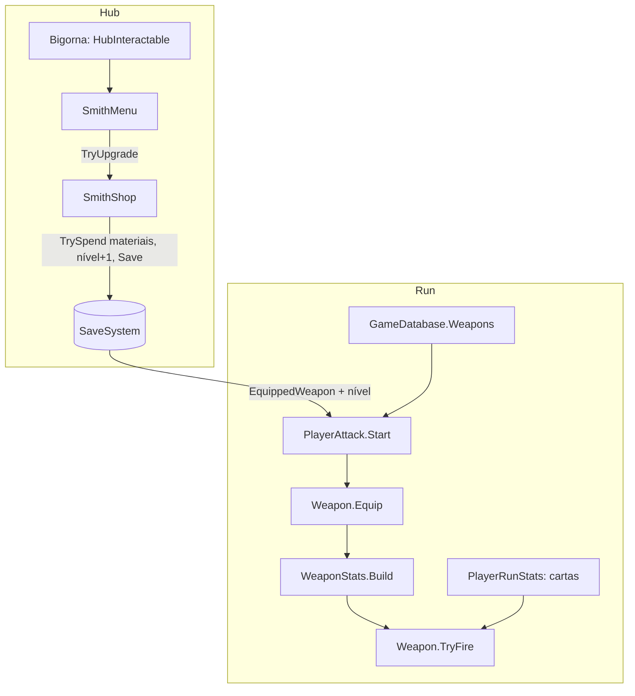

# Ferreiro: melhoria da arma Design

**Spec**: `.specs/features/blacksmith-weapon/spec.md`
**Status**: Approved
**Approved**: 2026-11-03 - user: "Aprovo todos"
**Revisão**: 2026-11-06 - ajustes da revisão contra o código atual (usuário: "Aplica os 7 ajustes"); aguardando nova aprovação.

---

## Architecture Overview

A arma deixa de ter os números presos no componente `Weapon` do prefab do player. Cada arma passa a ser um asset `WeaponData`, com:

- o projétil;
- o dano e a cadência base;
- a lista de níveis, em que cada nível traz seus bônus e seu custo.

O `WeaponCatalog` lista todas as armas e marca a arma inicial. Os dois ficam no `GameDatabase`.

Na run, o `PlayerAttack` pede ao save a arma equipada e o nível dela e chama `weapon.Equip(data, level)`. O `Weapon` monta um `WeaponStats` com a base mais a soma dos níveis 1 até o nível atual (SMITH-09). Depois disso, `TryFire` usa esses valores, e as cartas continuam multiplicando por cima (SMITH-10).

Na run, os números se juntam assim (SMITH-10), na fórmula que o `PlayerRunStats` já usa desde o padre:

- **Dano por tiro** = (dano do padre, pela Força + dano da arma no nível + dano fixo das cartas) x (1 + bônus de dano das cartas).
- **Cadência** = cadência da arma no nível x multiplicador de cadência do padre x (1 + bônus de cadência das cartas).
- **Projétil**: os bônus da arma no nível multiplicam os das cartas; a perfuração soma.

No hub, a bigorna abre o `SmithMenu`. A compra passa por `SmithShop`.



---

## Code Reuse Analysis

### Existing Components to Leverage

| Component | Location | How to Use |
| --------- | -------- | ---------- |
| `Weapon.TryFire` | `Assets/_Project/Code/Runtime/Combat/Weapon.cs:19` | Mantém a assinatura; passa a usar o projétil, o dano e a cadência do `WeaponStats` e a multiplicar os bônus de projétil da arma pelos das cartas. |
| `Projectile.Launch` | `Assets/_Project/Code/Runtime/Combat/Projectile.cs:26` | Já aceita multiplicadores de velocidade e de vida, e perfuração extra. Os níveis usam essas entradas, sem mudança no projétil. |
| `PlayerAttack` | `Assets/_Project/Code/Runtime/Player/PlayerAttack.cs` | Equipa a arma no `Start`. |
| `PlayerRunStats.CalculateDamage` | `Assets/_Project/Code/Runtime/Player/PlayerRunStats.cs:51` | Recebe `weapon.BaseDamage`, que agora já inclui os níveis, e soma o dano do padre (`StatBlock.Damage`) e o fixo das cartas antes do multiplicador. |
| `PermanentStats` / `StatBlock.FireRate` | `Assets/_Project/Code/Runtime/Player/PermanentStats.cs` | O multiplicador de cadência do padre continua entrando pelo `PlayerRunStats.FireRateMultiplier`; a arma não muda isso. |
| `CardCollection.OnValidate` | `Assets/_Project/Code/Runtime/Cards/CardCollection.cs` | Mesmo aviso de Id vazio ou repetido no `WeaponCatalog`. |
| `HubInteractable` da bigorna | Cena `Hub`, `Editor/HubSceneBuilder.cs` | `onClick` → `SmithMenu.Open()` (SMITH-01). |
| `HubCanvasBuilder` | `Assets/_Project/Code/Editor/HubCanvasBuilder.cs` | `BuildSmithMenu`, no mesmo estilo do padre, da fogueira e da mesa; `Build` ganha `out SmithMenu`. |
| `HubPanel` | feature `hub-flow` | Abrir, fechar e Esc (SMITH-07). |
| `SaveData.WeaponLevels`, `EquippedWeapon` | feature `save-system` | Nível por `WeaponData.Id`. |

### Integration Points

| System | Integration Method |
| ------ | ------------------ |
| `save-system` | `GetLevel(WeaponLevels, id)`; `Save()` após a melhoria (SAVE-13); arma inicial quando `EquippedWeapon` falta (SAVE-22); `Sanitize` tira de `WeaponLevels` os Ids vazios, repetidos e desconhecidos. |
| `Player.prefab` | O `Weapon` perde `projectilePrefab`, `damage` e `fireRate` serializados; fica com `muzzle` e `team`. |
| `GameDatabase` | Campo `Weapons` (`WeaponCatalog`). |

---

## Components

| Component | Quem escreve |
| --------- | ------------ |
| Tudo: código, assets, ícone e painel | Claude (usuário, em 2026-11-06: "Claude escreve tudo") |

### WeaponData e WeaponLevel

- **Purpose**: Uma arma como dado (SMITH-11, SMITH-12).
- **Location**: `Assets/_Project/Code/Runtime/Combat/WeaponData.cs`; assets em `Assets/_Project/Data/Weapons/`
- **Interfaces**:
  - identidade: `string Id`, `string DisplayName`, `Sprite Icon`, `Projectile ProjectilePrefab`
  - status base: `float BaseDamage` (10), `float BaseFireRate` (4)
  - `List<WeaponLevel> Levels`
  - `int MaxLevel => Levels.Count`
- **Reuses**: os valores atuais do `Weapon` no `Player.prefab` viram a base da arma inicial.

### WeaponCatalog

- **Purpose**: A lista das armas do jogo e a arma inicial (SMITH-13).
- **Location**: `Assets/_Project/Code/Runtime/Combat/WeaponCatalog.cs`; asset em `Assets/_Project/Data/Weapons/WeaponCatalog.asset`
- **Interfaces**: `IReadOnlyList<WeaponData> Weapons`, `WeaponData StartingWeapon`, `WeaponData Find(string id)` (ignora entradas nulas e sem Id; Id vazio devolve `null`).
- **OnValidate**: avisa arma sem Id e Id repetido, como o `CardCollection`.

### WeaponStats

- **Purpose**: Os números finais da arma num nível, antes das cartas.
- **Location**: `Assets/_Project/Code/Runtime/Combat/WeaponStats.cs`
- **Interfaces**:
  - `static WeaponStats Build(WeaponData data, int level)` - prende `level` em `0..MaxLevel` (SMITH-17) e soma os níveis 1 até `level`
  - campos `Damage`, `FireRate`, `ProjectileSpeedMultiplier`, `LifetimeMultiplier`, `BonusPierce`
  - o menu usa `Build(level)` e `Build(level + 1)` para "atual → próximo" (SMITH-03)

### Weapon (mudança)

- **Interfaces**:
  - `void Equip(WeaponData data, int level)` - guarda `data` e `stats`
  - `BaseDamage => stats.Damage`
  - `TryFire` usa `data.ProjectilePrefab` e `stats.FireRate`, e multiplica os bônus de projétil da arma pelos das cartas
  - sem arma equipada, `TryFire` devolve falso e registra um erro uma vez
- **Dependencies**: `WeaponData`, `WeaponStats`.

### PlayerAttack (mudança)

- **Interfaces**: no `Start`, pega o ID equipado do save, encontra a arma no `GameDatabase.Weapons` e o nível em `WeaponLevels`, e chama `weapon.Equip` (SMITH-08, SMITH-14).

### SmithShop e SmithMenu

- **Purpose**: Melhorar a arma equipada (SMITH-02 a SMITH-06, SMITH-15, SMITH-16, SMITH-18).
- **Location**: `Assets/_Project/Code/Runtime/Combat/SmithShop.cs` e `Assets/_Project/Code/Runtime/Hub/SmithMenu.cs`
- **Interfaces**:
  - `SmithShop.Equipped`, `SmithShop.Level`, `SmithShop.IsMaxed`
  - `SmithShop.NextCost` - `Levels[level].Cost`
  - `SmithShop.TryUpgrade()` - `TrySpend`, nível + 1, `NotifyChanged`, `Save`
  - `SmithMenu.Open()` mostra ícone, nome, "Nível N/M", linhas "atual → próximo" só dos status que mudam, custo por material (cor de aviso #C96D45 no que falta) e o botão "Forjar"; no máximo mostra "Arma no nível máximo"

---

## Data Models

```csharp
[Serializable]
public class WeaponLevel
{
    public float DamageBonus;            // somado ao dano, ex.: +2
    public float FireRateBonus;          // fração somada à cadência, ex.: 0,10 = +10%
    public float ProjectileSpeedBonus;   // fração
    public float LifetimeBonus;          // fração (alcance)
    public int PierceBonus;              // quantidade
    public ResourceBag Cost;             // só Bones/Iron/Wax
}
```

Arma inicial: 5 níveis, alternando `DamageBonus` 2 e `FireRateBonus` 0,10. Os custos têm 10, 20, 30, 40 e 50 materiais no total.

---

## Error Handling Strategy

| Error Scenario | Handling | User Impact |
| -------------- | -------- | ----------- |
| Materiais insuficientes | Botão desligado, material na cor de aviso; `TryUpgrade` devolve falso (SMITH-16) | Nada é cobrado. |
| Arma no último nível | "Arma no nível máximo", botão desligado (SMITH-15) | Nenhum. |
| Nível salvo acima de `MaxLevel` | `WeaponStats.Build` prende no último (SMITH-17) | Usa o último nível. |
| Arma equipada desconhecida | O save já troca pela inicial (SAVE-22) | Nenhum. |
| `WeaponCatalog` sem `StartingWeapon` | `Debug.LogError` no `GameDatabase.OnValidate` | Aparece no Editor antes de jogar. |
| `WeaponLevels` com Id vazio, repetido ou desconhecido | O `Sanitize` tira; o repetido fica com a primeira entrada | O nível da arma não é contado duas vezes. |
| Arma no catálogo sem Id | `Find` a ignora e o `OnValidate` avisa | Ela nunca é equipada por engano. |

---

## Risks & Concerns

| Concern | Location (file:line) | Impact | Mitigation |
| ------- | -------------------- | ------ | ---------- |
| Os números da arma estão serializados no `Player.prefab` | `Assets/_Project/Code/Runtime/Combat/Weapon.cs:10` | Ao tirar os campos, os valores atuais somem do prefab. | O Claude copia `projectilePrefab`, 10 de dano e 4 de cadência para `StartingWeapon.asset` antes da troca. |
| `Weapon` também foi pensado para bosses | `Assets/_Project/Code/Runtime/Combat/Weapon.cs:4` | Nenhum boss usa `Weapon` hoje (só o `Player.prefab`). | Registrado; uma arma de boss também seria um `WeaponData`. |
| A ordem `Awake`/`Start` entre `PlayerRunStats` e `PlayerAttack` | `Assets/_Project/Code/Runtime/Player/PlayerAttack.cs:18` | Atirar antes do `Equip` não tem arma. | `Equip` no `Start`, e `TryFire` devolve falso enquanto não houver arma. |

---

## Tech Decisions (only non-obvious ones)

| Decision | Choice | Rationale |
| -------- | ------ | --------- |
| Bônus por nível | Lista de `WeaponLevel` com todos os campos, somados até o nível atual | Cada arma tem seu caminho (spec); um campo zerado não muda nada. |
| Bônus de cadência | Fração somada (`1 + soma`), não multiplicada nível a nível | Igual à soma das cartas no `CardInventory.Total`. |
| Onde a arma é equipada | `PlayerAttack.Start` lendo o save | AD-003: trocar de arma é só mudar o ID no save. |
