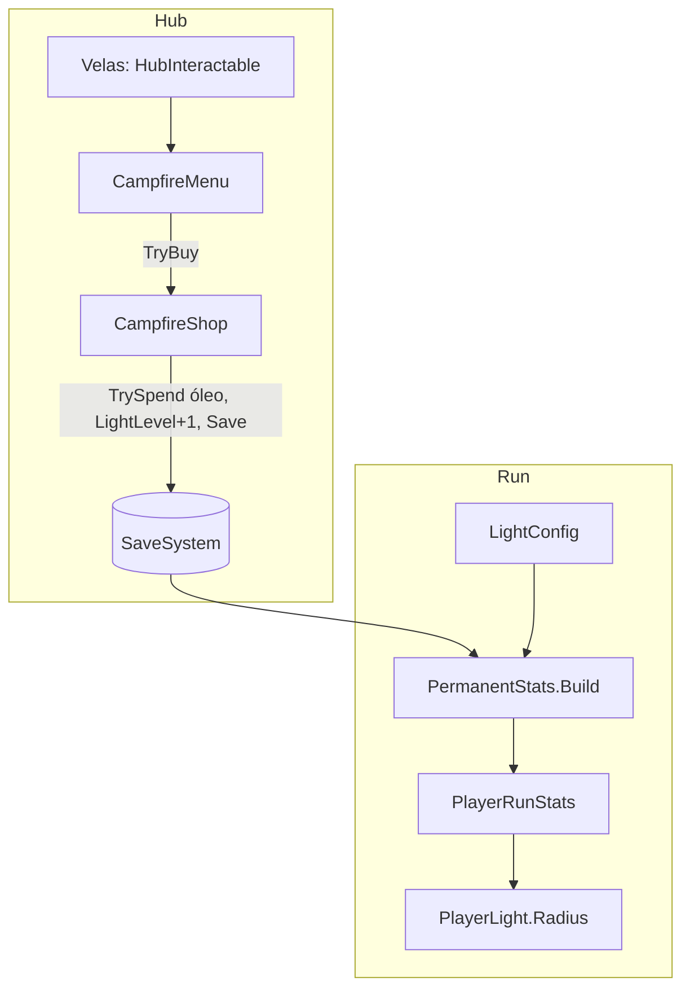

# Fogueira e óleo Design

**Spec**: `.specs/features/campfire-light/spec.md`
**Status**: Approved
**Approved**: 2026-11-03 - user: "Aprovo todos"

---

## Architecture Overview

O design tem duas metades ligadas pelo save.

**No hub.** O grupo de velas vira um `HubInteractable` que abre o `CampfireMenu`. A compra passa por `CampfireShop`, que gasta óleo com `SaveSystem.TrySpend` e sobe `SaveData.LightLevel`.

**Na run.** O raio da luz vem da fogueira:

- **Raio da luz.** O `PermanentStats` (feature `priest-stats`) tem duas versões de `Build`. A que lê o save, usada pela run, passa a preencher `LightRadius` com `LightRules.Radius(db.Light, save.LightLevel)`. A genérica, usada pelo menu do padre, deixa `LightRadius` em 0, porque o padre não mostra luz. Nenhuma das duas lê mais o `PlayerStats.LightRadius`, que sai na T5, e as cartas continuam multiplicando por cima (LIGHT-08, LIGHT-09).

Todos os números ficam no `LightConfig`. O óleo vem só dos bosses (`run-rewards`); não há orbes de óleo no mapa.

---

## Code Reuse Analysis

### Existing Components to Leverage

| Component | Location | How to Use |
| --------- | -------- | ---------- |
| `PlayerLight.Radius` | `Assets/_Project/Code/Runtime/Light/PlayerLight.cs` | Recebe o raio final, sem mudança. |
| `PermanentStats.Build` | feature `priest-stats` | A versão que lê o save preenche a luz; a genérica (menu do padre) deixa 0. |
| `HubInteractable` + `HubOutline.mat` | `Assets/_Project/Code/Runtime/Hub/HubInteractable.cs` | As velas ganham contorno e clique (LIGHT-01, LIGHT-02); o sprite `HubFlame` passa a ser importado com a margem de 2 px do contorno, como a igreja. |
| `HubPanel` | feature `hub-flow` | Abrir, fechar e Esc (LIGHT-07). |

### Integration Points

| System | Integration Method |
| ------ | ------------------ |
| `save-system` | `SaveData.LightLevel`; `Save()` após a compra (SAVE-03, SAVE-13). |
| `priest-stats` | Mesma `StatBlock`; o padre nunca mexe na luz. |
| `PlayerStats.asset` | O campo `LightRadius` sai, porque a base agora vem da fogueira. |

---

## Components

| Component | Quem escreve |
| --------- | ------------ |
| `LightConfig`, `LightRules`, `CampfireShop`, `CampfireMenu`, mudanças em `PermanentStats` e `PlayerStats` | Usuário |
| Velas clicáveis no hub, painel da fogueira no builder, `LightConfig.asset` | Claude |

### LightConfig

- **Purpose**: Os números da luz.
- **Location**: `Assets/_Project/Code/Runtime/Light/LightConfig.cs`; asset em `Assets/_Project/Data/Progression/LightConfig.asset`
- **Interfaces**:
  - nível de luz: `BaseRadius` 3,0, `RadiusPerLevel` 0,5, `MaxLevel` 10
  - custo: `BaseCost` 40, `CostStep` 20
- **Dependencies**: nenhuma.

### LightRules

- **Purpose**: Contas puras de raio e custo.
- **Location**: `Assets/_Project/Code/Runtime/Light/LightRules.cs`
- **Interfaces**:
  - `static float Radius(LightConfig c, int level)` - `BaseRadius + RadiusPerLevel × level` (LIGHT-08)
  - `static int CostOf(LightConfig c, int level)` - `BaseCost + CostStep × (level − 1)` para `level ≥ 1` (LIGHT-04)

### CampfireShop e CampfireMenu

- **Purpose**: Comprar o próximo nível (LIGHT-03 a LIGHT-06, LIGHT-16, LIGHT-17).
- **Location**: `Assets/_Project/Code/Runtime/Light/CampfireShop.cs` e `Assets/_Project/Code/Runtime/Hub/CampfireMenu.cs`
- **Interfaces**:
  - `CampfireShop.IsMaxed`
  - `CampfireShop.NextCost`
  - `CampfireShop.CanBuy`
  - `CampfireShop.TryBuy()` - `TrySpend(new ResourceBag { Oil = cost })`, `LightLevel++`, `NotifyChanged`, `Save`
  - `CampfireMenu.Open()` mostra "Nível N", "Raio atual → próximo", o custo em óleo (na cor de aviso da paleta quando falta) e o botão "Alimentar a chama"; no nível 10 mostra "Luz no máximo" e desliga o botão
- **Dependencies**: `LightConfig` (referência no menu e no `GameDatabase`), `SaveSystem`, `HubPanel`.

---

## Error Handling Strategy

| Error Scenario | Handling | User Impact |
| -------------- | -------- | ----------- |
| `LightLevel` salvo acima de 10 | `Mathf.Clamp` no `Radius` e no menu | Fica no máximo. |
| Óleo insuficiente | Botão desligado, custo na cor de aviso | Nada é cobrado. |

---

## Risks & Concerns

| Concern | Location (file:line) | Impact | Mitigation |
| ------- | -------------------- | ------ | ---------- |
| A luz inicial cai de 5,0 para 3,0 | `Assets/_Project/Data/Progression/PlayerStats.asset` | As ondas foram ajustadas com raio 5; o começo fica bem mais escuro e difícil. | Decisão aceita na spec. O ritmo das ondas só é reavaliado depois do hub (memória "pacing after HUB"). |
| `Spawner` e `BossSpawner` nascem inimigos fora da luz usando `PlayerLight.Radius` | `Assets/_Project/Code/Runtime/Run/Spawner.cs:43`, `Assets/_Project/Code/Runtime/Bosses/BossSpawner.cs:45` | Com raio 3, os inimigos nascem mais perto. | Comportamento desejado (seguem a luz); nenhuma mudança. |
| `PlayerStats.LightRadius` deixa de ser usado | `Assets/_Project/Code/Runtime/Player/PlayerStats.cs:27` | Um campo que não faz nada confunde no Inspector. | O campo sai do `PlayerStats`. |

---

## Tech Decisions (only non-obvious ones)

| Decision | Choice | Rationale |
| -------- | ------ | --------- |
| A fogueira no hub | O grupo de velas atual com `HubInteractable` | A spec deixa a fogueira animada fora do MVP. |
