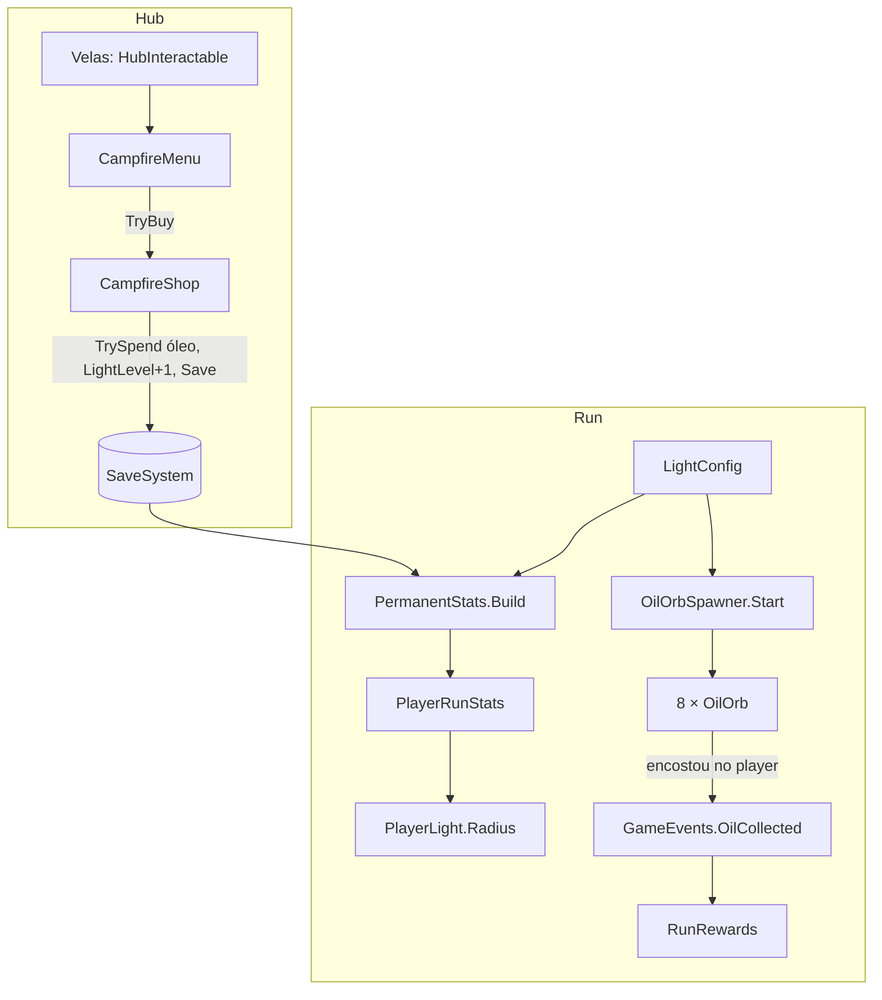

# Fogueira e óleo Design

**Spec**: `.specs/features/campfire-light/spec.md`
**Status**: Approved
**Approved**: 2026-11-03 - user: "Aprovo todos"

---

## Architecture Overview

O design tem duas metades ligadas pelo save.

**No hub.** O grupo de velas vira um `HubInteractable` que abre o `CampfireMenu`. A compra passa por `CampfireShop`, que gasta óleo com `SaveSystem.TrySpend` e sobe `SaveData.LightLevel`.

**Na run.** A luz e os orbes funcionam assim:

- **Raio da luz.** `PermanentStats.Build` (feature `priest-stats`) passa a preencher `LightRadius` com `LightRules.Radius(nível)`. Esse valor substitui o `PlayerStats.LightRadius`, e as cartas continuam multiplicando por cima (LIGHT-08, LIGHT-09).
- **Orbes.** Um `OilOrbSpawner` sorteia as posições no `Start`. Cada `OilOrb` levanta `GameEvents.OilCollected`, que o `RunRewards` soma (LIGHT-13).

Todos os números ficam no `LightConfig` (LIGHT-15).

---

## Code Reuse Analysis

### Existing Components to Leverage

| Component | Location | How to Use |
| --------- | -------- | ---------- |
| `PlayerLight.Radius` | `Assets/_Project/Code/Runtime/Light/PlayerLight.cs` | Recebe o raio final, sem mudança. |
| `PermanentStats.Build` | feature `priest-stats` | Ganha a linha da luz. |
| `XpOrb` | `Assets/_Project/Code/Runtime/Core/XpOrb.cs` | Mesmo padrão de coleta por `OnTriggerEnter2D` com a tag `Player`. O orbe de óleo não é atraído, porque a spec pede coleta ao encostar. |
| `HubInteractable` + `HubOutline.mat` | `Assets/_Project/Code/Runtime/Hub/HubInteractable.cs` | As velas ganham contorno e clique (LIGHT-01, LIGHT-02). |
| `HubPanel` | feature `hub-flow` | Abrir, fechar e Esc (LIGHT-07). |
| `RunRewards` | feature `run-rewards` | Já soma `OilCollected` e ignora depois do fim (LIGHT-19). |
| Material `Sprite-Unlit-Default` (URP) | pacote URP | O sprite do orbe não é afetado pela escuridão 2D e não emite luz (LIGHT-11, LIGHT-12). |

### Integration Points

| System | Integration Method |
| ------ | ------------------ |
| `save-system` | `SaveData.LightLevel`; `Save()` após a compra (SAVE-03, SAVE-13). |
| `priest-stats` | Mesma `StatBlock`; o padre nunca mexe na luz. |
| Cena `FirstOne` | Objeto `OilOrbSpawner` com o `LightConfig` e o prefab do orbe. |
| `PlayerStats.asset` | O campo `LightRadius` sai, porque a base agora vem da fogueira. |

---

## Components

| Component | Quem escreve |
| --------- | ------------ |
| `LightConfig`, `LightRules`, `CampfireShop`, `CampfireMenu`, `OilOrbSpawner`, `OilOrb`, mudanças em `PermanentStats` e `PlayerStats` | Usuário |
| Arte e prefab do orbe (`OilOrb.prefab`), velas clicáveis no hub, painel da fogueira no builder, `LightConfig.asset` com a área do mapa | Claude |

### LightConfig

- **Purpose**: Os números da luz e dos orbes.
- **Location**: `Assets/_Project/Code/Runtime/Light/LightConfig.cs`; asset em `Assets/_Project/Data/Progression/LightConfig.asset`
- **Interfaces**:
  - nível de luz: `BaseRadius` 3,0, `RadiusPerLevel` 0,5, `MaxLevel` 10
  - custo: `BaseCost` 40, `CostStep` 20
  - orbes: `OrbCount` 8, `OilPerOrb` 5, `MinDistanceFromStart` 6, `MinDistanceBetween` 4, `SpawnArea` (`Rect`), `MaxAttemptsPerOrb` 30
- **Dependencies**: nenhuma.

### LightRules

- **Purpose**: Contas puras de raio e custo.
- **Location**: `Assets/_Project/Code/Runtime/Light/LightRules.cs`
- **Interfaces**:
  - `static float Radius(LightConfig c, int level)` - `BaseRadius + RadiusPerLevel × level` (LIGHT-08)
  - `static int CostOf(LightConfig c, int level)` - `BaseCost + CostStep × (level − 1)` para `level ≥ 1` (LIGHT-04)
  - `static List<Vector2> PickOrbPositions(LightConfig c, Vector2 start, System.Random rng)` - sorteio com rejeição; devolve os que couberem (LIGHT-14, LIGHT-18)

### CampfireShop e CampfireMenu

- **Purpose**: Comprar o próximo nível (LIGHT-03 a LIGHT-06, LIGHT-16, LIGHT-17).
- **Location**: `Assets/_Project/Code/Runtime/Light/CampfireShop.cs` e `Assets/_Project/Code/Runtime/Hub/CampfireMenu.cs`
- **Interfaces**:
  - `CampfireShop.IsMaxed`
  - `CampfireShop.NextCost`
  - `CampfireShop.CanBuy`
  - `CampfireShop.TryBuy()` - `TrySpend(new ResourceBag { Oil = cost })`, `LightLevel++`, `NotifyChanged`, `Save`
  - `CampfireMenu.Open()` mostra "Nível N", "Raio atual → próximo", o custo em óleo (vermelho quando falta) e o botão "Alimentar a chama"; no nível 10 mostra "Luz no máximo" e desliga o botão
- **Dependencies**: `LightConfig` (referência no menu e no `GameDatabase`), `SaveSystem`, `HubPanel`.

### OilOrbSpawner

- **Purpose**: Espalhar os orbes no começo da run (LIGHT-10, LIGHT-14, LIGHT-18).
- **Location**: `Assets/_Project/Code/Runtime/Light/OilOrbSpawner.cs`
- **Interfaces**: no `Start`, `PickOrbPositions` a partir da posição do player; `Instantiate` de cada orbe com `Init(OilPerOrb)`; `Debug.LogWarning` quando couberem menos que `OrbCount`.

### OilOrb

- **Purpose**: O ponto de óleo no escuro (LIGHT-11 a LIGHT-13).
- **Location**: `Assets/_Project/Code/Runtime/Light/OilOrb.cs`; prefab em `Assets/_Project/Prefabs/Drops/OilOrb.prefab`
- **Interfaces**:
  - `Init(int oil)`
  - `Update` pulsa o alfa e a escala com `Mathf.Sin(Time.time × velocidade)`
  - `OnTriggerEnter2D` com a tag `Player` levanta `RaiseOilCollected(oil)` e se destrói
- **Arte**: sprite de 5 a 7 px, gota âmbar (255,209,128) com núcleo claro, material `Sprite-Unlit-Default`, `CircleCollider2D` trigger. Não tem `Light2D`.

---

## Error Handling Strategy

| Error Scenario | Handling | User Impact |
| -------------- | -------- | ----------- |
| Área pequena demais para 8 orbes | Cria os que couberem e registra um aviso (LIGHT-18) | Menos orbes naquela run. |
| `LightLevel` salvo acima de 10 | `Mathf.Clamp` no `Radius` e no menu | Fica no máximo. |
| Óleo insuficiente | Botão desligado, custo em vermelho | Nada é cobrado. |
| Player encosta depois do fim da run | `RunRewards` já parou de somar (LIGHT-19) | O orbe some, sem óleo. |

---

## Risks & Concerns

| Concern | Location (file:line) | Impact | Mitigation |
| ------- | -------------------- | ------ | ---------- |
| A luz inicial cai de 5,0 para 3,0 | `Assets/_Project/Data/Progression/PlayerStats.asset` | As ondas foram ajustadas com raio 5; o começo fica bem mais escuro e difícil. | Decisão aceita na spec. O ritmo das ondas só é reavaliado depois do hub (memória "pacing after HUB"). |
| `Spawner` e `BossSpawner` nascem inimigos fora da luz usando `PlayerLight.Radius` | `Assets/_Project/Code/Runtime/Run/Spawner.cs:43`, `Assets/_Project/Code/Runtime/Bosses/BossSpawner.cs:45` | Com raio 3, os inimigos nascem mais perto. | Comportamento desejado (seguem a luz); nenhuma mudança. |
| `PlayerStats.LightRadius` deixa de ser usado | `Assets/_Project/Code/Runtime/Player/PlayerStats.cs:27` | Um campo que não faz nada confunde no Inspector. | O campo sai do `PlayerStats`. |
| A área do mapa não existe como dado | Cena `FirstOne` | Sem um `Rect`, não há onde sortear. | O Claude mede a área do tilemap e preenche `SpawnArea` no `LightConfig.asset`. |

---

## Tech Decisions (only non-obvious ones)

| Decision | Choice | Rationale |
| -------- | ------ | --------- |
| Visível no escuro sem iluminar | Sprite com material unlit, sem `Light2D` | Atende LIGHT-11 e LIGHT-12 sem shader novo. |
| Sorteio dos orbes | Rejeição com `MaxAttemptsPerOrb` | Simples e com fim garantido. |
| A fogueira no hub | O grupo de velas atual com `HubInteractable` | A spec deixa a fogueira animada fora do MVP. |
