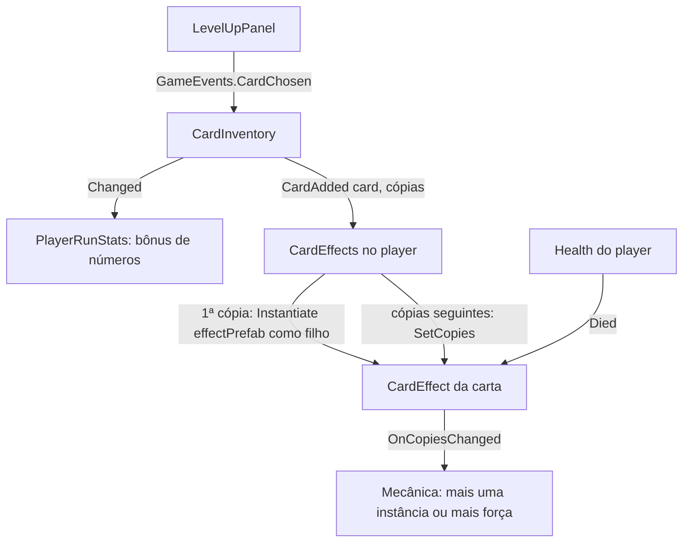

# Cartas com mecânica própria Design

**Spec**: `.specs/features/card-effects/spec.md`
**Status**: Draft

---

## Architecture Overview

A carta ganha um campo opcional, `effectPrefab`. O player ganha um componente novo, `CardEffects`, que ouve o `CardInventory`:

- Quando uma carta com efeito entra pela primeira vez, ele instancia o prefab como filho do player e entrega ao efeito o player e o número de cópias (1).
- Quando a mesma carta entra de novo, ele só avisa o efeito que já existe do novo número de cópias.

Cada mecânica é um script que herda de `CardEffect`. A classe base guarda o player, a carta e as cópias, e para o efeito quando o player morre. A mecânica decide o que fazer com as cópias: criar mais uma instância do que ela faz (duas explosões) ou ficar mais forte (a mesma explosão, maior).

Os bônus de números continuam como estão: o `PlayerRunStats` soma os campos do `CardData` pelo `CardInventory`, com ou sem efeito na carta (CEFX-04, CEFX-05).



O efeito vive dentro do player, na cena da run. Quando a run termina e a cena do hub carrega, ele some junto com o player, e a próxima run começa sem efeito nenhum (CEFX-11). Nada fica em estático nem no save.

---

## Code Reuse Analysis

### Existing Components to Leverage

| Component | Location | How to Use |
| --------- | -------- | ---------- |
| `CardData` | `Assets/_Project/Code/Runtime/Cards/CardData.cs` | Ganha o campo `effectPrefab` (`GameObject`) e a propriedade `EffectPrefab`, vazio nas 20 cartas (CEFX-01). |
| `CardInventory` | `Assets/_Project/Code/Runtime/Cards/CardInventory.cs` | Já conta as cópias por carta. Ganha o evento `CardAdded(CardData, int)`, disparado depois de contar. |
| `PlayerRunStats` | `Assets/_Project/Code/Runtime/Player/PlayerRunStats.cs` | Sem mudança: continua somando os bônus de todas as cartas (CEFX-04, CEFX-05). |
| `Health` | `Assets/_Project/Code/Runtime/Combat/Health.cs` | O `Died` do player para os efeitos (CEFX-12). Os efeitos dão dano por `TakeDamage(DamageInfo)`, como as armas. |
| `GameEvents` | `Assets/_Project/Code/Runtime/Core/GameEvents.cs` | As mecânicas ouvem os eventos que já existem (`EnemyKilled`, `LevelUp`...). |
| `Player.prefab` | `Assets/_Project/Prefabs/Player/Player.prefab` | Recebe o componente `CardEffects`. |

### Integration Points

| System | Integration Method |
| ------ | ------------------ |
| Level up | Nenhuma mudança: a carta escolhida entra pelo `CardChosen` → `CardInventory`, como hoje (CEFX-07). |
| Mesa de tarot | Nenhuma mudança: uma carta de efeito é um `CardData` na `CardCollection`, e desbloqueio, deck e sorteio a tratam igual (CEFX-09). A Coleção mostra a descrição da carta, que explica a mecânica. |
| Pausa | Level up e tela de resultado já põem `Time.timeScale = 0`. Mecânicas que usam tempo escalado (`Time.deltaTime`, `WaitForSeconds`, `Invoke`) param sozinhas (CEFX-06). |

---

## Components

| Component | Quem escreve |
| --------- | ------------ |
| `effectPrefab` no `CardData`, evento `CardAdded` no `CardInventory`, `CardEffect`, `CardEffects` | Usuário (AD-001) |
| `CardEffects` no `Player.prefab`, pasta dos prefabs de efeito | Claude |

### CardEffect (classe base)

- **Purpose**: O contrato de toda mecânica de carta: quem é o player, qual carta, quantas cópias, e parar quando o player morre.
- **Location**: `Assets/_Project/Code/Runtime/Cards/Effects/CardEffect.cs`
- **Interfaces**:
  - `public abstract class CardEffect : MonoBehaviour`
  - `protected GameObject Player { get; }` e `protected CardData Card { get; }` (CEFX-08)
  - `protected int Copies { get; }`
  - `public void Attach(GameObject player, CardData card)`: guarda os dois e se inscreve no `Health.Died` do player
  - `public void SetCopies(int copies)`: guarda e chama `OnCopiesChanged(copies)` (CEFX-02, CEFX-03)
  - `protected virtual void OnCopiesChanged(int copies)`: a mecânica decide o que muda com mais cópias
  - Ao `Died` do player: `enabled = false` e chama `protected virtual void OnPlayerDied()` (CEFX-12)
- **Regras para quem escreve uma mecânica**:
  - Inscrever-se nos eventos no `OnEnable` e sair no `OnDisable`, para que o `enabled = false` da morte desligue tudo.
  - Usar tempo escalado, nunca `unscaledDeltaTime` nem `WaitForSecondsRealtime`, para pausar junto com o jogo.
  - Ler o player pelo `Player` (`GetComponent<PlayerRunStats>()`, `Health`, `PlayerDodge`...) em vez de procurar na cena.
- **Dependencies**: `Health`.

### CardEffects (no player)

- **Purpose**: Criar o efeito na primeira cópia e avisar das seguintes.
- **Location**: `Assets/_Project/Code/Runtime/Cards/Effects/CardEffects.cs`
- **Interfaces**:
  - `[RequireComponent(typeof(CardInventory))]`
  - `OnEnable`/`OnDisable`: entra e sai do `inventory.CardAdded`
  - `private void OnCardAdded(CardData card, int copies)`:
    - sem `EffectPrefab`: não faz nada (CEFX-05);
    - já tem o efeito da carta: `effect.SetCopies(copies)` (CEFX-03);
    - senão: `Instantiate(card.EffectPrefab, transform)`, pega o `CardEffect`; sem ele, `Debug.LogWarning` com o Id da carta, destrói a instância e para (CEFX-10); com ele, `Attach(gameObject, card)` e `SetCopies(copies)` (CEFX-02).
  - Guarda um `Dictionary<CardData, CardEffect>`: um efeito por carta.
- **Dependencies**: `CardInventory`.
- **Reuses**: o mesmo padrão de componente no player do `PlayerRunStats` (lê o `CardInventory` do mesmo objeto).

### CardInventory (mudança)

- **Purpose**: Avisar qual carta entrou e com quantas cópias ficou.
- **Interfaces**: `public event Action<CardData, int> CardAdded`, disparado em `Add` depois de contar e antes do `Changed`.

---

## Data Models

```csharp
public class CardData : ScriptableObject
{
    // ... campos atuais
    [Tooltip("Prefab com um CardEffect: a mecânica própria da carta. Vazio = só números.")]
    [SerializeField] private GameObject effectPrefab;
    public GameObject EffectPrefab => effectPrefab;
}
```

Exemplo de mecânica (só para mostrar o contrato; não entra nesta feature):

```csharp
public class EmberBurstEffect : CardEffect
{
    [SerializeField] private int killsPerBurst = 5;
    private int kills;

    private void OnEnable() => GameEvents.EnemyKilled += OnEnemyKilled;
    private void OnDisable() => GameEvents.EnemyKilled -= OnEnemyKilled;

    private void OnEnemyKilled(int points)
    {
        if (++kills < killsPerBurst) return;
        kills = 0;
        for (int i = 0; i < Copies; i++) Burst(); // "mais uma instância" por cópia
    }

    private void Burst() { /* área de dano em volta do Player */ }
}
```

Nada vai para o save: o efeito existe só durante a run.

---

## Error Handling Strategy

| Error Scenario | Handling | User Impact |
| -------------- | -------- | ----------- |
| Prefab sem `CardEffect` (CEFX-10) | `CardEffects` registra um aviso com o Id da carta, destrói a instância e segue; os bônus de números já entraram pelo `PlayerRunStats` | A carta vale só pelos números; a run continua. |
| Player morre com efeitos ativos (CEFX-12) | `CardEffect` se desliga no `Died` | Nenhum efeito age depois da morte. |
| Jogo pausado (CEFX-06) | Mecânicas usam tempo escalado; nenhum evento de combate dispara com `timeScale` 0 | Nada acontece com o level up ou o resultado abertos. |
| Mecânica lança exceção | Não tratado pelo sistema: o erro aparece no Console como qualquer script | Só aquela mecânica falha. |

---

## Risks & Concerns

| Concern | Location (file:line) | Impact | Mitigation |
| ------- | -------------------- | ------ | ---------- |
| Ordem dos ouvintes do `CardChosen`: o `CardInventory` e um `CardEffects` ouvindo o mesmo evento estático não têm ordem garantida | `Assets/_Project/Code/Runtime/Cards/CardInventory.cs:17` | O efeito poderia receber o número de cópias antigo | O `CardEffects` ouve o `CardAdded` do `CardInventory`, que dispara depois de contar; não ouve o `CardChosen`. |
| O player não é desligado na morte: o `PlayerDeath` só dispara o `PlayerDied` | `Assets/_Project/Code/Runtime/Player/PlayerDeath.cs:29` | Um efeito continuaria agindo atrás da tela de resultado | A base desliga o efeito no `Health.Died` (CEFX-12). |
| Efeito com colisor como filho do player | `Assets/_Project/Prefabs/Player/Player.prefab` | Um gatilho do efeito pode acertar o próprio player ou contar como hitbox do player | Mecânicas com colisor usam o `Team`/`Hitbox` do projeto e uma layer própria; regra anotada para a primeira carta. |
| Nenhuma carta de efeito nesta feature | spec, Out of Scope | O sistema fica sem prova até existir uma carta | A spec fecha com a primeira carta real (decisão do usuário); as tasks de sistema fecham pelo gate de compilação. |

---

## Tech Decisions (only non-obvious ones)

| Decision | Choice | Rationale |
| -------- | ------ | --------- |
| Tipo do campo | `GameObject`, e não `CardEffect` | Um prefab com o script removido depois vira um aviso com o Id (CEFX-10), em vez de um campo que some calado. |
| Um efeito por carta | O sistema cria uma instância só e manda o número de cópias | O usuário: "depende da carta. isso será uma mecânica dela." A mecânica decide se duplica ou se fica mais forte. |
| Onde o efeito vive | Filho do player, na cena da run | Some com a cena no fim da run, sem limpeza manual (CEFX-11). |
| De onde vem a contagem | Evento `CardAdded` do `CardInventory` | Uma fonte só para as cópias, a mesma que soma os bônus. |
