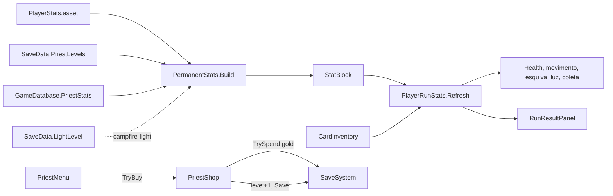

# Padre: status permanentes Design

**Spec**: `.specs/features/priest-stats/spec.md`
**Status**: Approved
**Approved**: 2026-11-03 - user: "Aprovo todos"

---

## Architecture Overview

Cada status do padre é um asset `PriestStatData`. Ele diz qual status do player muda (`PlayerStatType`), quanto cada ponto dá e quanto custa. A lista fica no `GameDatabase` e o nível de cada um, no save (`PriestLevels`).

A conta da base sai do `PlayerRunStats` e vai para uma classe pura, `PermanentStats`, que junta três fontes:

- o `PlayerStats.asset`;
- os pontos do padre;
- a luz da fogueira, que entra com a feature `campfire-light`.

O resultado é um `StatBlock`. O `PlayerRunStats` passa a aplicar as cartas sobre esse bloco, e não mais sobre o `PlayerStats` direto (PRST-08, PRST-09). Como a tela de resultado lê o `PlayerRunStats`, os pontos já aparecem nela (PRST-10).

---

## Code Reuse Analysis

### Existing Components to Leverage

| Component | Location | How to Use |
| --------- | -------- | ---------- |
| `PlayerStats` | `Assets/_Project/Code/Runtime/Player/PlayerStats.cs` | Continua sendo a base do jogo; nunca é escrito. |
| `PlayerRunStats.Refresh` | `Assets/_Project/Code/Runtime/Player/PlayerRunStats.cs:46` | Troca `baseStats.X` por `block.X`; o resto da conta das cartas fica igual. |
| `CardInventory.ReductionMultiplier` | `Assets/_Project/Code/Runtime/Cards/CardInventory.cs:38` | A redução da esquiva pelas cartas continua multiplicando por cima. |
| `HubInteractable` da igreja | `Assets/_Project/Scenes/Hub/Hub.unity` | `onClick` → `PriestMenu.Open()` (PRST-01). |
| `HubPanel` | feature `hub-flow` | Abrir, fechar e Esc (PRST-07). |
| `SaveSystem.TrySpend`, `SaveData.GetLevel/SetLevel` | feature `save-system` | Compra e nível. |

### Integration Points

| System | Integration Method |
| ------ | ------------------ |
| `save-system` | `PriestLevels` por `PriestStatData.Id`; `Save()` depois de cada compra (SAVE-13). |
| `campfire-light` | Adiciona a luz ao `PermanentStats.Build`. |
| `GameDatabase` | Campo `PriestStats` com os 5 assets, na ordem do menu. |

---

## Components

| Component | Quem escreve |
| --------- | ------------ |
| `PlayerStatType`, `PriestStatData`, `StatBlock`, `PermanentStats`, `PriestShop`, `PriestMenu`, mudança no `PlayerRunStats` | Usuário |
| `PriestStatRowView`, painel do padre no builder do hub, ícones dos 5 status, os 5 assets | Claude |

### PriestStatData

- **Purpose**: Um status que o padre sobe (PRST-11).
- **Location**: `Assets/_Project/Code/Runtime/Priest/PriestStatData.cs`; assets em `Assets/_Project/Data/Priest/`
- **Interfaces**:
  - `string Id`, `string DisplayName`, `Sprite Icon`
  - `PlayerStatType Stat` - qual status do `StatBlock` ele muda
  - `float GainPerLevel` - para `DodgeCooldown` é a fração tirada por ponto (0,03)
  - `int BaseCost` (5), `int CostStep` (5)
  - `int CostAt(int level) => BaseCost + CostStep * level` (PRST-06)
- **Dependencies**: nenhuma.
- **Reuses**: o formato de `CardData`.

### StatBlock e PermanentStats

- **Purpose**: Calcular a base da run antes das cartas.
- **Location**: `Assets/_Project/Code/Runtime/Player/PermanentStats.cs`
- **Interfaces**:
  - `struct StatBlock { MaxHealth, MoveSpeed, DodgeDistance, DodgeInvulnerability, DodgeCooldown, Damage, LightRadius, XpPickupRadius }`
  - `static StatBlock Build(PlayerStats baseStats, SaveData save, GameDatabase db)` - copia o `PlayerStats` e soma `GainPerLevel × nível` de cada status; para `DodgeCooldown` aplica `× (1 − ganho × nível)` e prende em 0,2 s (PRST-16)
  - `static float ValueAt(PriestStatData stat, float baseValue, int level)` - usada também pelo menu para "valor atual" e "próximo valor" (PRST-02)
- **Dependencies**: `PlayerStats`, `SaveData`, `GameDatabase`.
- **Reuses**: nada.

### PlayerRunStats (mudança)

- **Interfaces**: no `Awake`, `block = PermanentStats.Build(baseStats, SaveSystem.Data, SaveSystem.Database)`; `Refresh` usa `block` no lugar de `baseStats`. O piso de 0,2 s vale depois das cartas também.

### PriestShop

- **Purpose**: A regra de compra, separada da tela.
- **Location**: `Assets/_Project/Code/Runtime/Priest/PriestShop.cs`
- **Interfaces**:
  - `static int LevelOf(PriestStatData stat)`
  - `static int NextCost(PriestStatData stat)`
  - `static bool CanBuy(PriestStatData stat)`
  - `static bool TryBuy(PriestStatData stat)` - `TrySpend` de ouro, nível + 1, `NotifyChanged`, `Save` (PRST-03, PRST-04, PRST-15)
- **Dependencies**: `SaveSystem`.

### PriestMenu e PriestStatRowView

- **Purpose**: Listar os status e comprar (PRST-02, PRST-05, PRST-13, PRST-14).
- **Location**: `Assets/_Project/Code/Runtime/Priest/PriestMenu.cs` e `Assets/_Project/Code/Runtime/UI/PriestStatRowView.cs`
- **Interfaces**:
  - `PriestMenu.Open()` cria uma linha por item de `GameDatabase.PriestStats` (PRST-12) e assina `SaveSystem.Changed` para redesenhar
  - `PriestStatRowView.Show(icon, name, level, current, next, cost, canBuy, onBuy)`
- **Layout**: painel gótico com 5 linhas: ícone, nome, "Nv N", "atual → próximo", custo com ícone de ouro (vermelho quando falta) e botão "Abençoar".

---

## Error Handling Strategy

| Error Scenario | Handling | User Impact |
| -------------- | -------- | ----------- |
| Ouro insuficiente | Botão desligado, custo em vermelho; `TryBuy` devolve falso mesmo se chamado | Nada é cobrado. |
| Cliques rápidos | Cada clique roda `TryBuy` inteiro na thread principal | Um ponto por clique, ouro nunca negativo. |
| `PriestStatData` com `Id` vazio | Aviso do `GameDatabase.OnValidate`; o menu esconde a linha | O status não aparece até ter ID. |
| Nível salvo de um status que não existe mais | Fica no save, sem efeito | Nenhum. |

---

## Risks & Concerns

| Concern | Location (file:line) | Impact | Mitigation |
| ------- | -------------------- | ------ | ---------- |
| `PlayerRunStats.Awake` lê `baseStats` direto | `Assets/_Project/Code/Runtime/Player/PlayerRunStats.cs:39` | Sem a troca, os pontos não valem na run. | `block` calculado no `Awake` antes do primeiro `Refresh`. |
| `Health.SetMax` soma a diferença à vida atual | `Assets/_Project/Code/Runtime/Combat/Health.cs:59` | Começar com mais vida máxima já cura até o máximo, como esperado. | Nenhuma mudança; registrado. |
| Adicionar um status de verdade novo (ex.: defesa) pede um valor novo no enum | `PlayerStatType` (novo) | PRST-12 cobre mostrar no menu, não criar uma mecânica nova. | Um asset novo para um status já existente não pede código; uma mecânica nova pede. |

---

## Tech Decisions (only non-obvious ones)

| Decision | Choice | Rationale |
| -------- | ------ | --------- |
| Como o asset diz qual status muda | Enum `PlayerStatType` | Simples de escolher no Inspector e de conferir; sem reflexão por nome de campo. |
| Esquiva | Redução linear `1 − 0,03 × nível`, piso 0,2 s | A spec pede "-3%" por ponto e um piso. |
| Onde a base é montada | `PermanentStats.Build`, chamado pelo `PlayerRunStats` | AD-012: padre e fogueira entram na base num ponto só, antes das cartas. |
