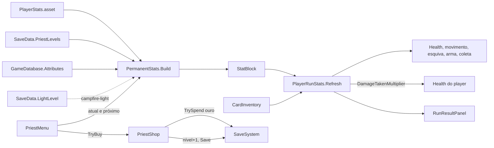

# Padre: atributos permanentes Design

**Spec**: `.specs/features/priest-stats/spec.md`
**Status**: Approved
**Approved**: 2026-11-04 - user: "Aprovo todas"

---

## Architecture Overview

Cada atributo do padre é um asset `AttributeData` com uma lista de efeitos. Cada efeito diz qual status do player muda (`PlayerStatType`) e quanto cada ponto dá. A lista de atributos fica no `GameDatabase`, e o nível de cada um no save (`PriestLevels`, chave = `AttributeData.Id`, AD-007).

A base da run sai do `PlayerRunStats` e vai para uma classe pura, `PermanentStats`, que junta:

- o `PlayerStats.asset`;
- os efeitos de todos os atributos, cada um vezes o nível do seu atributo;
- a luz da fogueira, que entra depois com a feature `campfire-light` (AD-012).

O resultado é um `StatBlock`. O `PlayerRunStats` aplica as cartas sobre esse bloco (PRST-10, PRST-15), prende a recarga da esquiva em 0,2 s e a defesa no teto (PRST-26, PRST-27), e passa a defesa para o `Health` do player, que reduz o dano recebido (PRST-17). Como a tela de resultado lê o `PlayerRunStats`, os pontos já aparecem nela (PRST-16).

O custo do próximo ponto depende só do nível do personagem, que é a soma dos níveis salvos (PRST-06, PRST-07). O menu usa o próprio `PermanentStats` para mostrar o valor atual e o valor com o próximo ponto de cada efeito: ele monta o bloco duas vezes, com o nível do atributo e com o nível + 1.

---

## Code Reuse Analysis

### Existing Components to Leverage

| Component | Location | How to Use |
| --------- | -------- | ---------- |
| `PlayerStats` | `Assets/_Project/Code/Runtime/Player/PlayerStats.cs` | Continua sendo a base; ganha `Defense` (0) e `DefenseCap` (0,6). Nunca é escrito em runtime. |
| `PlayerRunStats.Refresh` | `Assets/_Project/Code/Runtime/Player/PlayerRunStats.cs:51` | Troca `baseStats.X` por `block.X`; a conta das cartas fica igual. |
| `PlayerRunStats.CalculateDamage` | `Assets/_Project/Code/Runtime/Player/PlayerRunStats.cs:46` | `block.Damage` entra no lugar de `baseStats.Damage`: a Força vale para qualquer arma (PRST-12). |
| `Health.TakeDamage` | `Assets/_Project/Code/Runtime/Combat/Health.cs:30` | Multiplica o dano por `DamageTakenMultiplier` (1 por padrão; inimigos não mudam). |
| `HubInteractable` da igreja | `Assets/_Project/Scenes/Hub/Hub.unity` | `onClick` → `PriestMenu.Open()` (PRST-01). |
| `HubPanel`, `HubCanvasBuilder` | feature `hub-flow` | Abrir, fechar e Esc (PRST-09); o painel do padre é montado no mesmo Canvas. |
| `SaveSystem.TrySpend`, `SaveData.GetLevel/SetLevel` | feature `save-system` | Compra e nível. |

### Integration Points

| System | Integration Method |
| ------ | ------------------ |
| `save-system` | `PriestLevels` por `AttributeData.Id`; `Save()` depois de cada compra (SAVE-13). |
| `campfire-light` | Adiciona a luz ao `PermanentStats.Build`; o padre nunca mexe na luz. |
| `GameDatabase` | Lista `Attributes` com os 4 assets na ordem do menu, e o custo (`PriestBaseCost` 5, `PriestCostStep` 5). |
| `hub-flow` | O painel do padre é um `HubPanel` no Canvas do hub. |

---

## Components

| Component | Quem escreve |
| --------- | ------------ |
| `PlayerStatType`, `AttributeData`, defesa em `PlayerStats` e `Health`, `StatBlock`, `PermanentStats`, mudança no `PlayerRunStats`, `GameDatabase`, `PriestShop`, `PriestMenu` | Usuário |
| Os 4 assets de atributo, os ícones, `AttributeRowView`, o painel do padre no builder do hub | Claude |

### PlayerStatType e AttributeData

- **Purpose**: Um atributo do padre com os status que ele move (PRST-20).
- **Location**: `Assets/_Project/Code/Runtime/Priest/AttributeData.cs`; assets em `Assets/_Project/Data/Priest/`
- **Interfaces**:
  - `enum PlayerStatType { MaxHealth, Damage, MoveSpeed, DodgeDistance, DodgeCooldown, FireRate, ProjectileSpeed, XpPickupRadius, Defense }`
  - `[Serializable] struct AttributeEffect { PlayerStatType Stat; float GainPerLevel; }`
  - `AttributeData`: `string Id`, `string DisplayName`, `Sprite Icon`, `IReadOnlyList<AttributeEffect> Effects`
- **Dependencies**: nenhuma.
- **Reuses**: o formato de `CardData` (ID próprio, AD-007).

### Defesa

- **Purpose**: Reduzir o dano recebido pelo player (PRST-17, PRST-18).
- **Interfaces**:
  - `PlayerStats.Defense` (0) e `PlayerStats.DefenseCap` (0,6)
  - `Health.DamageTakenMultiplier { get; set; }` = 1; `TakeDamage` tira `info.Amount × DamageTakenMultiplier`
- **Dependencies**: nenhuma.

### StatBlock e PermanentStats

- **Purpose**: Calcular a base da run antes das cartas, e os valores que o menu mostra.
- **Location**: `Assets/_Project/Code/Runtime/Player/PermanentStats.cs`
- **Interfaces**:
  - `struct StatBlock { MaxHealth, MoveSpeed, DodgeDistance, DodgeInvulnerability, DodgeCooldown, Damage, LightRadius, XpPickupRadius, FireRate, ProjectileSpeed, Defense }` - `FireRate` e `ProjectileSpeed` são multiplicadores que começam em 1
  - `static StatBlock Build(PlayerStats baseStats, IEnumerable<AttributeData> attributes, Func<AttributeData, int> levelOf)` - copia o `PlayerStats` e soma `GainPerLevel × nível` de cada efeito no campo do seu `Stat` (PRST-10, PRST-22)
  - `static StatBlock Build(PlayerStats baseStats, SaveData save, GameDatabase db)` - atalho com os níveis do save, usado pelo `PlayerRunStats`
  - `static float Get(StatBlock block, PlayerStatType stat)` - o valor de um status, usado pelo menu
  - `static int CharacterLevel(SaveData save)` - soma de todos os `PriestLevels`, inclusive de atributos que não existem mais (PRST-06, PRST-28)
- **Dependencies**: `PlayerStats`, `SaveData`, `GameDatabase`, `AttributeData`.
- **Reuses**: nada.

### PlayerRunStats (mudança)

- **Interfaces**: no `Awake`, `block = PermanentStats.Build(baseStats, SaveSystem.Data, SaveSystem.Database)` antes do primeiro `Refresh`. O `Refresh` usa `block` no lugar de `baseStats`. `FireRateMultiplier = block.FireRate × cartas` e `ProjectileSpeedMultiplier = block.ProjectileSpeed × cartas`. A recarga da esquiva fica em no mínimo 0,2 s depois das cartas (PRST-26). `Defense = Mathf.Min(block.Defense, baseStats.DefenseCap)` (PRST-27), e `health.DamageTakenMultiplier = 1 − Defense`.

### GameDatabase (mudança)

- **Interfaces**: `IReadOnlyList<AttributeData> Attributes`, `AttributeData FindAttribute(string id)`, `int PriestBaseCost` (5), `int PriestCostStep` (5).

### PriestShop

- **Purpose**: A regra de compra, separada da tela.
- **Location**: `Assets/_Project/Code/Runtime/Priest/PriestShop.cs`
- **Interfaces**:
  - `static int LevelOf(AttributeData attribute)`
  - `static int CharacterLevel()` - `PermanentStats.CharacterLevel(SaveSystem.Data)`
  - `static int NextCost()` - `PriestBaseCost + PriestCostStep × CharacterLevel()` (PRST-07)
  - `static bool CanBuy()` - ouro do save ≥ `NextCost()`
  - `static bool TryBuy(AttributeData attribute)` - `TrySpend` do custo, nível + 1, `NotifyChanged`, `Save` (PRST-04, PRST-05, PRST-25)
- **Dependencies**: `SaveSystem`, `PermanentStats`.

### PriestMenu e AttributeRowView

- **Purpose**: Mostrar o nível, o custo e os atributos, e comprar (PRST-02, PRST-03, PRST-08, PRST-19, PRST-21, PRST-23, PRST-24).
- **Location**: `Assets/_Project/Code/Runtime/Priest/PriestMenu.cs` e `Assets/_Project/Code/Runtime/UI/AttributeRowView.cs`
- **Interfaces**:
  - `PriestMenu.Open()` - cria uma linha por item de `GameDatabase.Attributes`, assina `SaveSystem.Changed` enquanto aberto e redesenha tudo
  - `AttributeRowView.Show(icon, name, level, effectLines, canBuy, onBuy)` - `effectLines` são textos "Vida máxima 100 → 110"
  - Rótulo e formato de cada `PlayerStatType` num só lugar (`StatLabels`): defesa, cadência e velocidade do projétil em %, recarga em segundos
- **Layout**: painel gótico. No topo, "Nível N" e o custo com o ícone de ouro (vermelho quando falta). Embaixo, uma linha por atributo: ícone, nome, "Nv N", as linhas de efeito "atual → próximo" e o botão "Abençoar". Rodapé com "Fechar".

---

## Error Handling Strategy

| Error Scenario | Handling | User Impact |
| -------------- | -------- | ----------- |
| Ouro insuficiente | Botões desligados, custo em vermelho; `TryBuy` devolve falso mesmo se chamado | Nada é cobrado. |
| Cliques rápidos | Cada clique roda `TryBuy` inteiro na thread principal | Um ponto por clique, ouro nunca negativo. |
| `AttributeData` com `Id` vazio | Aviso no `GameDatabase.OnValidate`; o menu e a run ignoram o atributo | O atributo não aparece até ter ID. |
| Nível salvo de um atributo que não existe mais | Fica no save, sem efeito, e conta no nível do personagem | O custo não cai ao remover um atributo. |
| Defesa acima do teto | `Mathf.Min` com `DefenseCap` | O dano nunca zera. |

---

## Risks & Concerns

| Concern | Location (file:line) | Impact | Mitigation |
| ------- | -------------------- | ------ | ---------- |
| `PlayerRunStats.Awake` lê `baseStats` direto | `Assets/_Project/Code/Runtime/Player/PlayerRunStats.cs:35` | Sem a troca, os pontos não valem na run. | `block` calculado no `Awake` antes do primeiro `Refresh`. |
| `Health` é de todo mundo, não só do player | `Assets/_Project/Code/Runtime/Combat/Health.cs` | A defesa poderia afetar inimigos por engano. | `DamageTakenMultiplier` começa em 1 e só o `PlayerRunStats` muda. |
| Um status totalmente novo pede código | `PlayerStatType` | PRST-22 cobre efeitos com status que já existem, não mecânicas novas. | Registrado: novo atributo ou novo efeito com status existente não pede código; um status novo (como a defesa agora) pede. |
| `campfire-light` foi desenhada sobre o `PermanentStats` antigo | `.specs/features/campfire-light/design.md` | A assinatura de `Build` mudou. | A fogueira só preenche `LightRadius` no mesmo `StatBlock`; revisar o design dela ao começar. |

---

## Tech Decisions (only non-obvious ones)

| Decision | Choice | Rationale |
| -------- | ------ | --------- |
| Como o efeito diz qual status muda | Enum `PlayerStatType` | Simples de escolher no Inspector; sem reflexão por nome de campo. |
| Todos os efeitos somam | `GainPerLevel` somado ao campo; a recarga da esquiva usa ganho negativo (−0,04 s) e cadência e projétil somam ao multiplicador (0,02 = +2%) | Uma regra só para qualquer efeito; o asset decide o sinal. |
| Valores "atual → próximo" no menu | `PermanentStats.Build` duas vezes, com o nível e com o nível + 1 | O menu mostra exatamente a conta que a run vai usar. |
| Onde fica o custo | `GameDatabase.PriestBaseCost` e `PriestCostStep` | O custo é do personagem, não de um atributo; balanceável no Inspector. |
| Defesa no `Health` | `DamageTakenMultiplier` | Um ponto só para reduzir dano; cartas de defesa no futuro usam o mesmo campo. |
