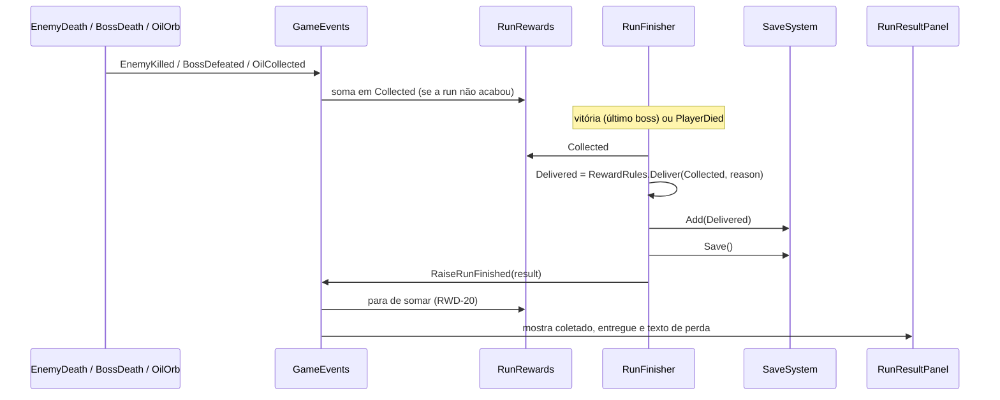

# Recompensas da run Design

**Spec**: `.specs/features/run-rewards/spec.md`
**Status**: Approved
**Approved**: 2026-11-03 - user: "Aprovo todos"

---

## Architecture Overview

Um componente novo na cena da run, `RunRewards`, soma o que foi coletado num `ResourceBag`. Ele escuta dois eventos: `EnemyKilled` (sorteio de material) e `BossDefeated` (ouro e óleo do boss). O `OilCollected` dos orbes de óleo existiu até 2026-11-04 e saiu com eles (AD-016). Os números vêm do asset `RewardConfig`.

O save não muda durante a run (RWD-12). No fim, o `RunFinisher` pede o coletado ao `RunRewards`, calcula o entregue com `RewardRules.Deliver`, soma ao save, grava e só então levanta `RunFinished`. Assim a tela de resultado já recebe as duas quantidades no `RunResult`.



---

## Code Reuse Analysis

### Existing Components to Leverage

| Component | Location | How to Use |
| --------- | -------- | ---------- |
| `GameEvents.EnemyKilled` | `Assets/_Project/Code/Runtime/Core/GameEvents.cs:9` | Já é levantado uma vez por monstro comum morto por dano (`EnemyDeath`). Os bosses não levantam esse evento. |
| `GameEvents.BossDefeated` | `Assets/_Project/Code/Runtime/Core/GameEvents.cs:12` | Traz o índice do boss, que vira o índice da recompensa no `RewardConfig`. |
| Limpeza de marco do `Spawner` | `Assets/_Project/Code/Runtime/Run/Spawner.cs:108` | Usa `Destroy`, sem `Health.Died`; RWD-19 já vale sem código novo. |
| `RunFinisher.BuildResult` | `Assets/_Project/Code/Runtime/Run/RunFinisher.cs:55` | Ganha as recompensas e a entrega ao save. |
| `RunResult` | `Assets/_Project/Code/Runtime/Run/RunResult.cs` | Troca os cinco `int` soltos por `Collected` e `Delivered` (`ResourceBag`). |
| `RunResultPanel`, `StatEntryView`, `RunResultScreenBuilder` | `Assets/_Project/Code/Runtime/UI/`, `Assets/_Project/Code/Editor/` | O bloco de recompensas entra na tela atual, com as mesmas molduras góticas. |
| `ResourceBag`, `SaveSystem` | feature `save-system` | Soma, metade e gravação. |

### Integration Points

| System | Integration Method |
| ------ | ------------------ |
| `save-system` | `SaveSystem.Add(delivered)` e `SaveSystem.Save()` antes de `RaiseRunFinished` (RWD-11, SAVE-12). |
| `campfire-light` | `OilOrb` levanta `GameEvents.RaiseOilCollected(amount)`. |
| Cena `FirstOne` | Objeto da run recebe o componente `RunRewards`; `RunFinisher` ganha a referência. |

---

## Components

| Component | Quem escreve |
| --------- | ------------ |
| `RewardConfig`, `RunRewards`, `RewardRules`, mudanças em `GameEvents`, `RunResult` e `RunFinisher` | Usuário |
| `RewardEntryView`, bloco de recompensas no `RunResultPanel` e no `RunResultScreenBuilder`, ícones dos 5 recursos, `RewardConfig.asset` | Claude |

### RewardConfig

- **Purpose**: Guardar os números das recompensas, editáveis no Inspector (RWD-07).
- **Location**: `Assets/_Project/Code/Runtime/Run/RewardConfig.cs`; asset em `Assets/_Project/Data/Run/RewardConfig.asset`
- **Interfaces**:
  - `float MaterialChance` (0,2)
  - `BossReward[] Bosses` - um por boss, na ordem do índice: `Gold`, `Oil` (sem materiais no MVP, RWD-05)
- **Dependencies**: nenhuma.
- **Reuses**: o formato de `RunConfig`.

### RunRewards

- **Purpose**: Somar o que a run coletou, sem tocar no save.
- **Location**: `Assets/_Project/Code/Runtime/Run/RunRewards.cs`
- **Interfaces**:
  - `ResourceBag Collected { get; }`
  - escuta `EnemyKilled`, `BossDefeated`, `OilCollected` e `RunFinished` (este último liga `finished`, que ignora tudo depois; RWD-20, LIGHT-19)
- **Dependencies**: `RewardConfig`, `GameEvents`.
- **Reuses**: o padrão `OnEnable`/`OnDisable` de `RunProgress`.

### RewardRules

- **Purpose**: As regras puras de sorteio e de perda, sem `MonoBehaviour`.
- **Location**: `Assets/_Project/Code/Runtime/Run/RewardRules.cs`
- **Interfaces**:
  - `static ResourceBag Deliver(ResourceBag collected, RunEndReason reason)` - vitória entrega tudo; qualquer outro motivo entrega `collected.Halved()` (RWD-09, RWD-10, RWD-18)
  - `static ResourceBag RandomMaterials(int count, System.Random rng)` - cada unidade vira osso, ferro ou cera com a mesma chance (RWD-02)
- **Dependencies**: `ResourceBag`.
- **Reuses**: nada.

### GameEvents (mudança)

- **Purpose**: Novo aviso de óleo coletado.
- **Location**: `Assets/_Project/Code/Runtime/Core/GameEvents.cs`
- **Interfaces**: `event Action<int> OilCollected` e `RaiseOilCollected(int amount)`.

### RunFinisher (mudança)

- **Purpose**: Entregar as recompensas antes de avisar o fim da run.
- **Interfaces**: nova referência `[SerializeField] RunRewards rewards`; `Finish(RunEndReason)` monta o resultado, chama `SaveSystem.Add(result.Delivered)`, `SaveSystem.Save()` e `RaiseRunFinished`. Um `bool finished` impede entregar duas vezes.

### RewardEntryView e bloco de recompensas

- **Purpose**: Mostrar cada recurso com ícone, nome e quantidade (RWD-13, RWD-14, RWD-21).
- **Location**: `Assets/_Project/Code/Runtime/UI/RewardEntryView.cs`
- **Interfaces**: `Show(int delivered)` mostra só "N"; `Show(int collected, int delivered)` mostra "coletado → entregue".
- **Layout**: bloco novo entre o resumo e os status, com 5 entradas em linha e a linha de perda embaixo (RWD-15, RWD-16). O painel cresce em altura o necessário; o resto da tela fica como está (RWD-17).
- **Reuses**: `StatEntryView` e as molduras de `RunResultScreenBuilder`.

---

## Data Models

```csharp
[Serializable]
public struct BossReward
{
    public int Gold;       // 10, 20, 40
    public int Oil;        // 30, 30, 50
}

public class RunResult
{
    // ... campos atuais, menos Gold/Oil/Bones/Iron/Wax
    public ResourceBag Collected;  // RWD-08
    public ResourceBag Delivered;  // o que foi somado ao save
}
```

---

## Error Handling Strategy

| Error Scenario | Handling | User Impact |
| -------------- | -------- | ----------- |
| Índice de boss fora de `RewardConfig.Bosses` | `Debug.LogError` e nenhuma recompensa daquele boss | O boss não rende nada; a run continua. |
| `RewardConfig` sem referência na cena | `Debug.LogError` no `Awake` e `RunRewards` desligado | A run termina com 0 de tudo. |
| Morte e vitória no mesmo frame | `RunFinisher.finished` aceita só o primeiro | Uma entrega só. |
| `RunRewards` sem referência no `RunFinisher` | `Debug.LogError` e entrega de 0 | A tela mostra 0. |

---

## Risks & Concerns

| Concern | Location (file:line) | Impact | Mitigation |
| ------- | -------------------- | ------ | ---------- |
| `RunFinisher` levanta `RunFinished` toda vez que o último boss ou o player morre, sem trava | `Assets/_Project/Code/Runtime/Run/RunFinisher.cs:40` | Duas entregas ao save se a vitória e a morte acontecerem juntas. | `bool finished` no `RunFinisher`. |
| `EnemyKilled` também alimenta pontos e abates | `Assets/_Project/Code/Runtime/Run/RunProgress.cs:17` | Se um boss passar a levantar `EnemyKilled`, ele também sortearia material comum. | O sorteio comum fica preso a `EnemyKilled`, que hoje só o `EnemyDeath` levanta; registrado aqui para quem mudar os bosses. |
| `UnityEngine.Random` compartilhado com o spawn | `RunRewards` (novo) | Nenhum para o jogo, mas o sorteio não dá para repetir num teste. | `RewardRules` recebe um `System.Random`; `RunRewards` cria o seu. |

---

## Tech Decisions (only non-obvious ones)

| Decision | Choice | Rationale |
| -------- | ------ | --------- |
| Quem entrega ao save | `RunFinisher`, antes de `RaiseRunFinished` | O save fica atualizado antes de qualquer tela ou troca de cena ouvir o fim da run. |
| Motivo `Quit` | Entrega metade, como morte | O comentário atual do `RunResult` já trata a saída como perda; hoje nada levanta `Quit`. |
| Materiais do boss | Sorteio unidade a unidade | Mesmo resultado esperado do monstro comum, sem tabela nova. |
