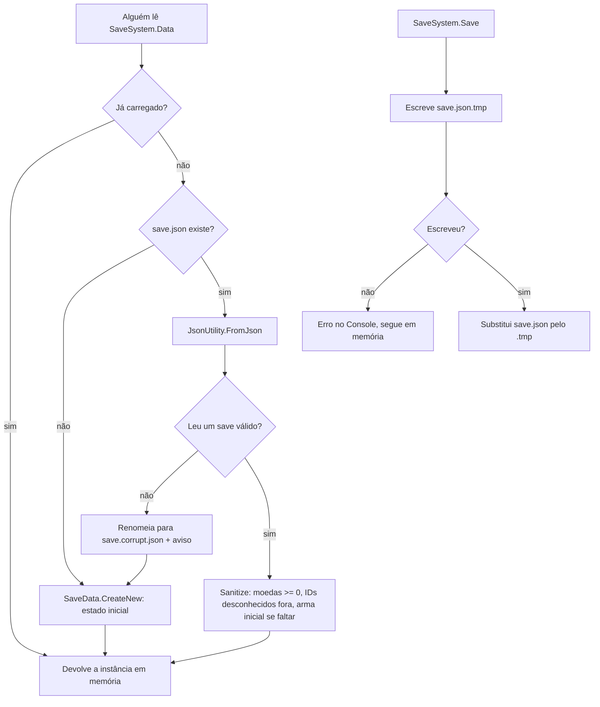

# Sistema de save Design

**Spec**: `.specs/features/save-system/spec.md`
**Status**: Approved
**Approved**: 2026-11-03 - user: "Aprovo todos"

---

## Architecture Overview

O save é uma classe estática, `SaveSystem`, que carrega o arquivo na primeira vez que alguém pede `SaveSystem.Data` e guarda uma única instância de `SaveData` em memória até o jogo fechar. Por ser estática, ela não depende de cena: funciona igual dando Play no `Hub` ou direto no `FirstOne`. Os assets que o save precisa conhecer (todas as cartas, o deck inicial, as armas e os status do padre) ficam num único asset, `GameDatabase`, carregado de `Resources`.

As outras features só falam com o save por três portas: ler `SaveSystem.Data`, mudar valores pelos métodos do `SaveSystem` (que avisam `Changed`) e chamar `SaveSystem.Save()`.



---

## Code Reuse Analysis

### Existing Components to Leverage

| Component | Location | How to Use |
| --------- | -------- | ---------- |
| `CardCollection` | `Assets/_Project/Code/Runtime/Cards/CardCollection.cs` | Vira a lista oficial de cartas e ganha `Find(id)` e o `OnValidate` de IDs; o `GameDatabase` aponta para ele e delega a busca. Falta criar o asset (`CardCollection.asset`) com as 20 cartas. |
| `DeckData` (`Deck.asset`) | `Assets/_Project/Code/Runtime/Cards/DeckData.cs` | Passa a ser o deck inicial: as cartas dele são as cartas padrão liberadas e o deck da primeira run. Ganha `MinCards` e `MaxCards` públicos. |
| `CardData` | `Assets/_Project/Code/Runtime/Cards/CardData.cs` | Ganha o campo `Id` (AD-007). |
| `JsonUtility` | Unity | Serializa `SaveData`. Não aceita `Dictionary`, por isso os níveis viram listas de pares. |

### Integration Points

| System | Integration Method |
| ------ | ------------------ |
| `RunFinisher` | Soma as recompensas e chama `SaveSystem.Save()` no fim da run (feature `run-rewards`). |
| Menus do hub | Compram pelos métodos do `SaveSystem` e chamam `Save()` (features `priest-stats`, `campfire-light`, `tarot-table`, `blacksmith-weapon`). |
| Contador de recursos do hub | Escuta `SaveSystem.Changed` (feature `hub-flow`). |
| `PlayerRunStats`, `Weapon`, `LevelUpPanel` | Leem `SaveSystem.Data` no começo da run. |

---

## Components

| Component | Quem escreve |
| --------- | ------------ |
| `SaveData`, `IdLevel`, `ResourceBag`, `SaveSystem`, `GameDatabase` | Usuário |
| `SaveMenu` (Editor), `GameDatabase.asset`, `CardCollection.asset`, preencher os `Id` das 20 cartas | Claude |

### ResourceBag

- **Purpose**: Guardar uma quantidade de cada recurso (ouro, óleo, osso, ferro, cera). É o mesmo tipo usado no save, nas recompensas e nos custos.
- **Location**: `Assets/_Project/Code/Runtime/Save/ResourceBag.cs`
- **Interfaces**:
  - campos `Gold`, `Oil`, `Bones`, `Iron`, `Wax` (`int`)
  - `ResourceBag operator +(ResourceBag a, ResourceBag b)` e `operator -`
  - `bool Covers(ResourceBag cost)` - verdadeiro quando cada campo é maior ou igual ao do custo
  - `ResourceBag Halved()` - cada campo dividido por 2, arredondado para baixo (usado em `run-rewards`)
  - `ResourceBag ClampedToZero()` - troca negativos por 0 (SAVE-20)
- **Dependencies**: nenhuma.
- **Reuses**: substitui os campos `Gold`, `Oil`, `Bones`, `Iron` e `Wax` soltos do `RunResult`.

### SaveData

- **Purpose**: Os dados gravados no arquivo, sem lógica de disco.
- **Location**: `Assets/_Project/Code/Runtime/Save/SaveData.cs`
- **Interfaces**:
  - `static SaveData CreateNew(GameDatabase db)` - estado inicial de SAVE-10
  - `int GetLevel(List<IdLevel> list, string id)` e `void SetLevel(List<IdLevel> list, string id, int level)` - leitura e escrita dos níveis por ID
- **Dependencies**: `GameDatabase` (só em `CreateNew`).
- **Reuses**: `ResourceBag`.

### SaveSystem

- **Purpose**: Carregar, validar, guardar em memória e gravar o save. É a única classe que toca no arquivo.
- **Location**: `Assets/_Project/Code/Runtime/Save/SaveSystem.cs`
- **Interfaces**:
  - `static SaveData Data { get; }` - carrega na primeira leitura (SAVE-09, SAVE-10, SAVE-11)
  - `static GameDatabase Database { get; }` - `Resources.Load<GameDatabase>("GameDatabase")`
  - `static event Action Changed` - avisa qualquer mudança feita pelos métodos abaixo
  - `static bool TrySpend(ResourceBag cost)` - tira o custo se `Covers`, avisa `Changed` e devolve se conseguiu
  - `static void Add(ResourceBag amount)` - soma recursos e avisa `Changed`
  - `static void NotifyChanged()` - para mudanças de nível e de deck feitas direto em `Data`
  - `static void Save()` - grava com arquivo temporário (SAVE-15, SAVE-21)
  - `static string FilePath` - `Path.Combine(Application.persistentDataPath, "save.json")`
  - `static void ResetForTests()` - esquece a instância em memória (usado pelo menu do Editor)
- **Dependencies**: `SaveData`, `GameDatabase`, `System.IO`, `JsonUtility`.
- **Reuses**: nada; é novo.

### GameDatabase

- **Purpose**: Um ponto só com todos os assets que o save precisa achar por ID.
- **Location**: `Assets/_Project/Code/Runtime/Save/GameDatabase.cs`; asset em `Assets/_Project/Resources/GameDatabase.asset`
- **Interfaces**:
  - campos `CardCollection` (`CardCollection`), `StartingDeck` (`DeckData`), `Weapons` (`WeaponCatalog`, feature `blacksmith-weapon`), `PriestStats` (`List<PriestStatData>`, feature `priest-stats`), `Light` (`LightConfig`, feature `campfire-light`)
  - `CardData FindCard(string id)`, `WeaponData FindWeapon(string id)`, `PriestStatData FindPriestStat(string id)` - `null` quando não existe; cada um delega ao `Find(id)` da sua lista (`CardCollection.Find`, `WeaponCatalog.Find`)
  - a validação de ID vazio ou repetido fica no `OnValidate` de cada lista, não no `GameDatabase`
- **Dependencies**: os tipos de dados de cada feature.
- **Reuses**: `CardCollection`, `DeckData`.

### SaveMenu (Editor)

- **Purpose**: Menu "Last Wick/Apagar save" (SAVE-16).
- **Location**: `Assets/_Project/Code/Editor/SaveMenu.cs`
- **Interfaces**: `[MenuItem("Last Wick/Apagar save")] static void DeleteSave()` - apaga `save.json` e chama `SaveSystem.ResetForTests()`.
- **Dependencies**: `SaveSystem.FilePath`.
- **Reuses**: o padrão de menus dos builders do Editor.

---

## Data Models

### SaveData (JSON)

```csharp
[Serializable]
public class SaveData
{
    public int Version = 1;                         // SAVE-08
    public ResourceBag Resources;                   // SAVE-01
    public List<IdLevel> PriestLevels = new();      // SAVE-02
    public int LightLevel;                          // SAVE-03
    public List<string> UnlockedCards = new();      // SAVE-04
    public List<string> Deck = new();               // SAVE-05, na ordem montada
    public List<IdLevel> WeaponLevels = new();      // SAVE-06
    public string EquippedWeapon;                   // SAVE-07
}

[Serializable]
public struct IdLevel { public string Id; public int Level; }
```

Exemplo do arquivo:

```json
{
  "Version": 1,
  "Resources": { "Gold": 35, "Oil": 60, "Bones": 4, "Iron": 2, "Wax": 3 },
  "PriestLevels": [ { "Id": "vida", "Level": 2 } ],
  "LightLevel": 1,
  "UnlockedCards": [ "chama-certeira", "pavio-longo" ],
  "Deck": [ "chama-certeira", "pavio-longo" ],
  "WeaponLevels": [ { "Id": "arma-inicial", "Level": 1 } ],
  "EquippedWeapon": "arma-inicial"
}
```

**Relationships**: os `Id` de `UnlockedCards` e `Deck` vêm de `CardData.Id`; `WeaponLevels` e `EquippedWeapon`, de `WeaponData.Id`; `PriestLevels`, de `PriestStatData.Id`. O deck é sempre um subconjunto das cartas liberadas.

---

## Error Handling Strategy

| Error Scenario | Handling | User Impact |
| -------------- | -------- | ----------- |
| `save.json` não existe | `CreateNew` | Começa do zero, sem aviso. |
| JSON inválido ou `FromJson` devolve `null` | `File.Move` para `save.corrupt.json` (apaga o `.corrupt` anterior), `Debug.LogWarning`, `CreateNew` (SAVE-17, SAVE-18) | Começa do zero; o arquivo ruim fica guardado. |
| `Version` maior que a suportada | Tratado como inválido | Igual ao caso acima. |
| ID de carta ou arma sem asset | Removido da lista, `Debug.LogWarning` com o ID (SAVE-19) | Perde só aquela carta ou arma. |
| Deck com carta não liberada | Removida do deck | Nenhum; o portão pede para montar o deck se ficar abaixo de 10. |
| Moeda negativa | `ClampedToZero` (SAVE-20) | Nenhum. |
| `EquippedWeapon` vazio ou desconhecido | Usa `Weapons.StartingWeapon` (SAVE-22) | Nenhum. |
| Erro de disco ao gravar (`IOException`, `UnauthorizedAccessException`) | `Debug.LogError`, segue com os valores em memória (SAVE-21) | O progresso desta sessão continua; pode se perder ao fechar. |

---

## Risks & Concerns

| Concern | Location (file:line) | Impact | Mitigation |
| ------- | -------------------- | ------ | ---------- |
| Estado estático sobrevive entre Play Modes quando "Enter Play Mode Options" desliga o domain reload | `SaveSystem` (novo) | O Play seguinte usa os dados velhos da memória. | `[RuntimeInitializeOnLoadMethod(RuntimeInitializeLoadType.SubsystemRegistration)]` zera a instância e o evento `Changed`. |
| `CardData` não tem `Id` hoje | `Assets/_Project/Code/Runtime/Cards/CardData.cs:3` | Sem ID, nada liga o save à carta (AD-007). | Campo `Id` novo; o Claude preenche as 20 cartas; `GameDatabase.OnValidate` avisa sobre vazio ou repetido. |
| `CardCollection` existe como script, mas não como asset | `Assets/_Project/Data/Cards/` | Não há lista com as 20 cartas. | O Claude cria `CardCollection.asset` com as 20. |
| `Deck.asset` é escrito em Play Mode por `TryAdd`/`Remove` | `Assets/_Project/Code/Runtime/Cards/DeckData.cs:22` | Mudar um ScriptableObject em Play Mode altera o asset no Editor. | O deck do jogador vive só no `SaveData`; `DeckData` vira só leitura (perde `TryAdd` e `Remove`). |
| Não há testes automáticos no projeto (nenhum `.asmdef` de código) | `Assets/_Project/Code/` | As regras só são conferidas à mão. | Conferência manual escolhida na spec; as regras ficam em classes C# puras (`ResourceBag`, `SaveData`) para dar para testar depois sem reescrever. |

---

## Tech Decisions (only non-obvious ones)

| Decision | Choice | Rationale |
| -------- | ------ | --------- |
| Onde o save vive | Classe estática com carga preguiçosa | Funciona em qualquer cena sem objeto de bootstrap; dar Play no `FirstOne` continua funcionando. |
| Como o save acha os assets | `GameDatabase` em `Resources` | Um único `Resources.Load`, sem ligar referências em cada cena. |
| Serializador | `JsonUtility` | Já vem na Unity; os níveis viram listas `IdLevel` porque ele não aceita `Dictionary`. |
| Troca do arquivo | `File.Replace` quando `save.json` existe, `File.Move` quando não | `File.Replace` falha se o destino não existe. |
| Quem grava | Quem muda chama `Save()`; o `SaveSystem` não grava sozinho a cada mudança | Uma compra muda vários valores e deve gerar uma gravação só. |

> AD-008, AD-009 e AD-010 registram como regra do projeto o save estático, o `GameDatabase` e o `ResourceBag`.
