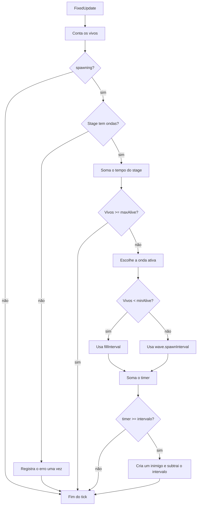

# Spawn por ondas Design

**Spec**: `.specs/features/spawn-waves/spec.md`
**Status**: Approved

---

## Architecture Overview

O `Spawner` continua sendo o único dono do spawn. `SpawnStage` passa a guardar uma lista de ondas, e a cada `FixedUpdate` o `Spawner` escolhe a onda ativa pelo tempo do stage e o intervalo pelos inimigos vivos. O fluxo de marcos e bosses não muda: `stageTime` só é zerado quando o boss morre.



---

## Code Reuse Analysis

### Existing Components to Leverage

| Component | Location | How to Use |
| --------- | -------- | ---------- |
| `SpawnStage` | `Assets/_Project/Code/Runtime/Run/SpawnEntry.cs` | Recebe `waves` e mantém `enemies` e `maxAlive`. |
| `PickEnemy` | `Assets/_Project/Code/Runtime/Run/Spawner.cs:98` | Continua sorteando pelos pesos do stage, sem mudança. |
| `GetSpawnPosition` | `Assets/_Project/Code/Runtime/Run/Spawner.cs:119` | Continua definindo onde cada inimigo nasce, sem mudança. |
| Padrão de subtração do `PickEnemy` | `Assets/_Project/Code/Runtime/Run/Spawner.cs:105` | `CurrentWave` usa a mesma ideia: subtrai `duration` em vez de `weight`. |

### Integration Points

| System | Integration Method |
| ------ | ------------------ |
| `RunProgress` | Sem mudança: continua levantando `MilestoneReached`. |
| `BossSpawner` e `BossDeath` | Sem mudança: `OnBossDefeated` só passa a zerar `stageTime` e o aviso de stage sem ondas. |
| `RunTimer` e `RunFinisher` | Sem mudança. |
| `RunConfig.asset` | Marcos voltam a 3000/7500/14000. |
| Cena `FirstOne` | O componente `Spawner` do objeto na cena recebe as ondas pelo Inspector. |

---

## Components

### SpawnWave

- **Purpose**: Guardar o ritmo de um trecho do stage.
- **Location**: `Assets/_Project/Code/Runtime/Run/SpawnEntry.cs`
- **Interfaces**: campos públicos `duration`, `minAlive` e `spawnInterval`, serializados no Inspector.
- **Dependencies**: nenhuma.
- **Reuses**: o formato `[System.Serializable]` de `SpawnEntry`.

### SpawnStage

- **Purpose**: Agrupar as ondas, a mistura de inimigos e o limite técnico de um stage.
- **Location**: `Assets/_Project/Code/Runtime/Run/SpawnEntry.cs`
- **Interfaces**: `enemies`, `waves` e `maxAlive`. Perde `spawnInterval`.
- **Dependencies**: `SpawnEntry`, `SpawnWave`.
- **Reuses**: a classe atual.

### Spawner

- **Purpose**: Decidir quando criar cada inimigo durante a run.
- **Location**: `Assets/_Project/Code/Runtime/Run/Spawner.cs`
- **Interfaces**:
  - `[SerializeField, Min(0.02f)] private float fillInterval = 0.1f` - intervalo usado abaixo do `minAlive`.
  - `private float stageTime` - segundos do stage atual.
  - `private bool missingWavesLogged` - impede repetir o erro de stage sem ondas.
  - `private SpawnWave CurrentWave(SpawnStage stage)` - devolve a onda ativa.
- **Dependencies**: `SpawnStage`, `SpawnWave`, `GameEvents`, `PlayerLight`.
- **Reuses**: `PickEnemy`, `GetSpawnPosition`, `OnMilestoneReached`, `OnStageCleared`.

Regras de `CurrentWave`:

1. Copia `stageTime` para uma variável local.
2. Percorre `stage.waves` na ordem.
3. Pula a onda com `duration <= 0`.
4. Retorna a onda quando o tempo restante for menor que sua `duration`.
5. Caso contrário, subtrai a `duration` e continua.
6. Se o loop terminar, retorna `stage.waves[^1]`.

---

## Data Models

```csharp
[System.Serializable]
public class SpawnWave
{
    public float duration = 30f;
    public int minAlive = 10;
    public float spawnInterval = 0.5f;
}

[System.Serializable]
public class SpawnStage
{
    public SpawnEntry[] enemies;
    public SpawnWave[] waves;
    public int maxAlive = 50;
}
```

Valores provisórios para a cena `FirstOne`, a ajustar em playtest:

| Stage | `maxAlive` | Ondas (`duration` / `minAlive` / `spawnInterval`) |
| ----- | ---------- | ------------------------------------------------- |
| 1 | 50 | 40 / 10 / 0,8 → 40 / 25 / 0,5 → 15 / 8 / 1,2 → 30 / 35 / 0,4 |
| 2 | 120 | 40 / 25 / 0,6 → 40 / 50 / 0,4 → 15 / 15 / 1 → 30 / 80 / 0,3 |
| 3 | 250 | 40 / 50 / 0,5 → 40 / 100 / 0,3 → 15 / 30 / 0,8 → 30 / 160 / 0,25 |

---

## Error Handling Strategy

| Error Scenario | Handling | User Impact |
| -------------- | -------- | ----------- |
| Stage sem ondas | Sai do `FixedUpdate` e chama `Debug.LogError` uma vez por stage | Nenhum inimigo nasce e o Console explica o motivo |
| `duration <= 0` | `CurrentWave` pula a onda | A onda não acontece |
| Todas as ondas com `duration <= 0` | `CurrentWave` retorna a última | O stage fica nessa onda |
| `minAlive` maior que `maxAlive` | A checagem de `maxAlive` vem antes da escolha do intervalo | Os vivos param em `maxAlive` |
| `enemies` vazio | Comportamento atual: `PickEnemy` retorna `null` e nada nasce | Nenhum inimigo nasce nesse stage |

---

## Risks & Concerns

| Concern | Location (file:line) | Impact | Mitigation |
| ------- | -------------------- | ------ | ---------- |
| Perda do valor serializado | `Assets/_Project/Scenes/Maps/FirstOne.unity:830` | Remover `spawnInterval` antes de preencher as ondas deixaria os stages sem ritmo | As ondas entram na cena antes de o código passar a usá-las; a remoção do campo é a T6. |
| Commits misturados | `Assets/_Project/Scenes/Maps/FirstOne.unity` | A cena, o `RunConfig.asset` e outros arquivos já têm mudanças não commitadas, que entrariam nos commits das tasks | Commitar o trabalho atual antes da T1, ou commitar a feature inteira de uma vez no fim. |
| Sem testes automatizados | `Assets/_Project/Code/Tests` | Uma mudança futura no spawn pode quebrar uma regra sem aviso | Decisão do usuário: cada critério é conferido manualmente em Play Mode. |
| Contagem custosa | `Assets/_Project/Code/Runtime/Run/Spawner.cs:43` | `FindGameObjectsWithTag` roda a cada `FixedUpdate`, e o stage 3 chega a 250 inimigos | Fora do escopo; medir no Profiler se houver queda de desempenho. |
| Import sem uso | `Assets/_Project/Code/Runtime/Run/Spawner.cs:2` | `using NUnit.Framework` pode quebrar o build fora do Editor | Removido na T5. |
| Teste longo dos marcos | `Assets/_Project/Data/Run/RunConfig.asset:16` | Com 3000/7500/14000, cada conferência dos bosses leva vários minutos | Conferir stages e bosses com os valores atuais e voltar os marcos na T7, a última task. |

---

## Tech Decisions

| Decision | Choice | Rationale |
| -------- | ------ | --------- |
| Onde fica a lógica | Dentro do `Spawner`, sem classe nova ou asmdef | O usuário escolheu teste manual; separar a lógica só serviria para testes automatizados. |
| Tempo do stage com `maxAlive` cheio | `stageTime` continua contando | A onda depende do tempo do stage, não dos vivos. |
| Timer com `maxAlive` cheio | Não acumula, como hoje | Evita uma rajada quando abrir vaga. |
| Reabastecimento | Um único `timer` para os dois intervalos | Menos estado e no máximo um spawn por tick. |
