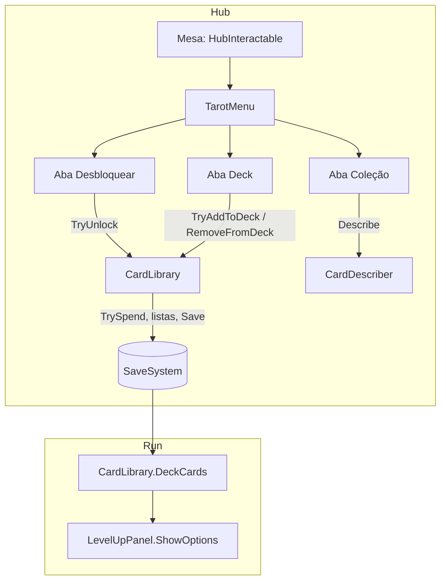

# Mesa de tarot: cartas e deck Design

**Spec**: `.specs/features/tarot-table/spec.md`
**Status**: Approved
**Approved**: 2026-11-03 - user: "Aprovo todos"

---

## Architecture Overview

As regras de carta ficam numa classe pura, `CardLibrary`, que lê e muda `SaveData.UnlockedCards` e `SaveData.Deck`. Tudo que a mesa mostra sai dela:

- quais cartas estão bloqueadas;
- o que pode entrar no deck;
- o contador "Liberadas: N/M".

A tela (`TarotMenu`, com três abas) só desenha o que a `CardLibrary` responde e chama os métodos dela.

Na run, o `LevelUpPanel` deixa de ler o `Deck.asset` e passa a sortear de `CardLibrary.DeckCards()`, que transforma os IDs do deck salvo em `CardData` (TAROT-16). O `Deck.asset` continua existindo, mas só como deck inicial e fonte das regras de 10 a 15.



---

## Code Reuse Analysis

### Existing Components to Leverage

| Component | Location | How to Use |
| --------- | -------- | ---------- |
| `CardData` | `Assets/_Project/Code/Runtime/Cards/CardData.cs` | Ganha `Id` (save-system) e `UnlockCost` (`ResourceBag`, só osso, ferro e cera). |
| `CardCollection` | `Assets/_Project/Code/Runtime/Cards/CardCollection.cs` | Lista oficial e ordem da Coleção (TAROT-07). |
| `DeckData` (`Deck.asset`) | `Assets/_Project/Code/Runtime/Cards/DeckData.cs` | Cartas padrão, deck inicial, `MinCards` e `MaxCards`. Perde `TryAdd` e `Remove`. |
| `LevelUpPanel.ShowOptions` | `Assets/_Project/Code/Runtime/UI/LevelUpPanel.cs:52` | Troca `deck.Cards` por `CardLibrary.DeckCards()`. |
| `CardSlotView` e o prefab `CardSlot` | `Assets/_Project/Code/Runtime/UI/CardSlotView.cs` | Célula de carta nas três abas, com o ícone padrão quando a carta não tem arte. |
| `HubPanel` | feature `hub-flow` | Abrir, fechar e Esc (TAROT-06). |
| `SaveSystem.TrySpend` | feature `save-system` | Custo do desbloqueio (TAROT-03). |

### Integration Points

| System | Integration Method |
| ------ | ------------------ |
| `save-system` | `UnlockedCards` e `Deck`; `Save()` a cada desbloqueio e a cada mudança de deck (SAVE-13, SAVE-14, TAROT-15). |
| `hub-flow` | `ExpeditionPanel` usa `CardLibrary.IsDeckValid` (HUB-13). |
| Cena `FirstOne` | `LevelUpPanel` perde a referência ao `Deck.asset`. |

---

## Components

| Component | Quem escreve |
| --------- | ------------ |
| `CardLibrary`, `CardDescriber`, `TarotMenu` e as três abas, mudanças em `CardData`, `DeckData` e `LevelUpPanel` | Usuário |
| Painel da mesa com abas no builder do hub, `CardDetailView`, `UnlockRowView`, custos nos 20 assets | Claude |

### CardLibrary

- **Purpose**: As regras de desbloqueio e de deck, sobre o save.
- **Location**: `Assets/_Project/Code/Runtime/Cards/CardLibrary.cs`
- **Interfaces**:
  - `static IReadOnlyList<CardData> All` - `GameDatabase.Cards.Cards`
  - `static bool IsUnlocked(CardData c)`
  - `static bool IsInDeck(CardData c)`
  - `static IEnumerable<CardData> Locked()` - em ordem da coleção (TAROT-02, TAROT-21)
  - `static int UnlockedCount` - para "Liberadas: N/M" (TAROT-10)
  - `static bool TryUnlock(CardData c)` - `TrySpend(UnlockCost)`, adiciona o ID, `NotifyChanged`, `Save` (TAROT-03, TAROT-04)
  - `static bool CanAddToDeck(CardData c)` - liberada, fora do deck e deck abaixo de `MaxCards` (TAROT-12, TAROT-18, TAROT-20)
  - `static bool TryAddToDeck(CardData c)` e `static void RemoveFromDeck(CardData c)` - mudam a lista, `NotifyChanged`, `Save` (TAROT-13, TAROT-15)
  - `static int DeckCount`
  - `static bool IsDeckValid` - entre `MinCards` e `MaxCards`
  - `static List<CardData> DeckCards()` - IDs do deck convertidos em cartas, ignorando os desconhecidos (TAROT-16)
- **Dependencies**: `SaveSystem`, `GameDatabase`.

### CardDescriber

- **Purpose**: As linhas de efeito de uma carta, só dos bônus diferentes de zero (TAROT-08, TAROT-22).
- **Location**: `Assets/_Project/Code/Runtime/Cards/CardDescriber.cs`
- **Interfaces**: `static List<string> Lines(CardData c)` - por exemplo "+20% dano", "+1 perfuração", "-20% recarga da esquiva".
- **Reuses**: os nomes dos status que a tela de resultado já usa.

### TarotMenu e abas

- **Purpose**: O painel com Desbloquear, Coleção e Deck.
- **Location**: `Assets/_Project/Code/Runtime/Hub/TarotMenu.cs`, `TarotUnlockTab.cs`, `TarotCollectionTab.cs`, `TarotDeckTab.cs`
- **Interfaces**:
  - `TarotMenu.Open()` abre na aba Desbloquear (TAROT-01)
  - `ShowTab(int)`
  - cada aba tem `Refresh()`, chamado ao abrir a aba e a cada `SaveSystem.Changed`
- **Layout**:
  - **Desbloquear.** Lista de linhas com ícone, nome, custo (vermelho no que falta) e botão "Desbloquear". Sem cartas bloqueadas, mostra "Todas as cartas foram liberadas."
  - **Coleção.** Grade de 20 cartas à esquerda (as bloqueadas escurecidas, com "Bloqueada") e detalhe à direita (nome, ícone, descrição, linhas de efeito, custo quando bloqueada), com "Liberadas: N/M" no topo.
  - **Deck.** Duas grades: "No deck" e "Disponíveis". Um clique move a carta de uma para a outra. No topo ficam "Deck: N/15" e o aviso de mínimo.

---

## Data Models

```csharp
public class CardData : ScriptableObject
{
    public string Id;                 // AD-007
    public string Name;
    public string Description;
    public Sprite Icon;
    public ResourceBag UnlockCost;    // só Bones/Iron/Wax; provisório 15 no total
    // ... bônus atuais
}
```

---

## Error Handling Strategy

| Error Scenario | Handling | User Impact |
| -------------- | -------- | ----------- |
| Materiais insuficientes | Botão desligado e custo em vermelho; `TryUnlock` devolve falso (TAROT-17) | Nada é cobrado. |
| Deck cheio | Cartas "Disponíveis" sem clique (TAROT-18) | Precisa tirar uma antes. |
| Deck abaixo de 10 | Aviso "O deck precisa de pelo menos 10 cartas." (TAROT-19); o portão bloqueia a partida | Não parte até corrigir. |
| Deck salvo com menos de 3 cartas na run (Play direto no `FirstOne` com save ruim) | `LevelUpPanel` completa as opções com cartas do `Deck.asset` e registra um aviso | A run não trava. |
| Carta com `UnlockCost` zerado | Desbloqueio grátis | Útil para teste; registrado. |

---

## Risks & Concerns

| Concern | Location (file:line) | Impact | Mitigation |
| ------- | -------------------- | ------ | ---------- |
| `LevelUpPanel` tira 3 cartas sem conferir se existem 3 | `Assets/_Project/Code/Runtime/UI/LevelUpPanel.cs:56` | `ArgumentOutOfRange` com um deck pequeno. | Completa com o `Deck.asset` (ver acima). |
| `DeckData.TryAdd`/`Remove` escrevem no asset | `Assets/_Project/Code/Runtime/Cards/DeckData.cs:22` | Mudar o deck em Play Mode alteraria o asset do projeto. | Os métodos saem; o deck do jogador vive no save. |
| `CardSlotView` foi feito para a tela de resultado (mostra quantidade) | `Assets/_Project/Code/Runtime/UI/CardSlotView.cs` | A mesa precisa de estado bloqueado e de clique. | `CardSlotView` ganha `SetLocked(bool)` e um `Button` opcional; a tela de resultado continua igual. |

---

## Tech Decisions (only non-obvious ones)

| Decision | Choice | Rationale |
| -------- | ------ | --------- |
| Onde ficam as regras de deck | `CardLibrary` estática sobre o save | A mesa, o portão e o level up usam a mesma resposta. |
| Lista de cartas na run | Convertida dos IDs do save a cada level up | Sem cópia que possa ficar diferente do save. |
| Custo de carta | `ResourceBag` no próprio `CardData` | Cada carta pode ter seu custo (AD-010). |
